# SH✡MER: Event lifecycle spec (SOS event control)

> Planning pass, 2026-11-03. Nothing in the code has changed yet.
> Problem (Dave, 3 Nov): *"When shomers arrive to help, they need to be able to communicate from the event and 'close' it, or escalate to additional emergency services if needed. Right now the whole operational side is confused, the workflow is weird and not coherent between users and the system dashboard. All components must agree and communicate events perfectly."*
>
> Line numbers refer to `origin/main` @ `5ed7fb1` (`shomer.html`, `dashboard.html`, `functions/`, `database.rules.json` in this repo) and to `3shamrocksstudio.github.io` @ `2ff667e` (`shomer-command/app/dashboard.html`, shown as **CMD**). Other agents are editing `shomer.html` right now, so the line numbers will drift. Search for the function names.

---

## 1. The current event model, read from the code

### 1.1 Where an SOS is created and what it carries

| Step | Code | What happens |
|---|---|---|
| Press | `onSosTap` 5936, `triggerSOS` 5388, `beginSOS` 5410 | `sosPhase='countdown'`. The local siren starts. Nothing leaves the phone. |
| Countdown cancel | `cancelCountdown` 5463 | Back to `idle`. No trace is left, so it counts as a false alarm (local counter only). |
| Countdown ends | `activateSOS` 5480 | `sosPhase='active'`, `curSosId='s'+Date.now()`, `curSosType='unknown'` (5499) |
| Broadcast A, "bus" | `sosBroadcast` 12845 → `invites/sos_<uid>_<salt>` | `{fromUid, ts, name:"1\|name\|lat\|lng\|tag"}`. These are the 60-character packed rules-era payloads. |
| Broadcast B, record | `fbPublishSOS` 11495 → `sos/<uid>` | `{uid,id,lat,lng,type,typeState,ts,resolved:false,repeated?}`. There is one record per person, and each new SOS overwrites it. |
| Public row | `fbDashSos` 11515 → `dashown/sf_<rand>` + `dashfeed/sf_<rand>` | `{type, lat,lng (2 dp), ts, status:'active'}` |
| Push | `fbAlertPairedSos` 13834 → `alarms/*` → `alarmFanout`; and `sosFanout` (functions/index.js 27) on `sos/{id}` write; and `fbTriggerPush` 11510 (Worker URL is empty, line 57) | **Not deployed** (FIREBASE-DEPLOY.md 6-7) |
| Heartbeat | `sosHeartbeat` 12896, every 4 min | Updates `ts` on the bus and on `sos/<uid>`. The **dashfeed row is never refreshed.** |
| Type | `classifySOS` 3240 → `fbUpdateSOSType` 11511 | Updates `sos/<uid>.type`. The dashfeed row is **not** updated. |

**States today:**
- Phone (`sosPhase`): `idle → countdown → active → idle`.
- Server (`sos/<uid>`): `resolved:false → true`.
- Local outcome (`resolveAs` 5911): `real | accidental | test`. This value stays on the phone and is never sent.
- Dashboard: `active | resolved`, plus the operator's own `open | handled | closed`, which is kept only in that browser's localStorage.

### 1.2 Who sees it

| Role | What they get today | Code |
|---|---|---|
| Sender | A red strip "SOS פעיל". A help bar "עזרה בדרך" with responder names and the nearest distance. A "help is coming" sound layer. A "call police?" bar after 2 s. A restore bar after a reload. | 5527-5555, 13221, 13172, 12931 |
| Sender's SHOMERs (paired) | A full-screen `in-sos` overlay with a siren (`playAlarm(2500)` 13018), a map pin, and a separate "live event" card | `showIncomingSOS` 13034, `fbSosProcess` 11546, `openLiveSosDetail` 11641 |
| Nearby users (not paired) | **Nothing in the app.** `incomingSosAlert` / `showSosBanner` (11585/11615) are never called. `sos/<uid>` can be read only by people the sender paired with (rules 66). `sosFanout` would push to them (≤5 km, functions 46), but when they open the app there is nothing to see. | |
| Municipal dashboard | An anonymous dashfeed row. It is polled every 12 s (dashboard.html 1503). | dashboard.html 1451-1490 |

### 1.3 Actions per role today

| Action | Sender | Paired SHOMER | Dashboard operator |
|---|---|---|---|
| Accept / on my way | – | "אני בדרך" in the overlay (13048) or on the event card (11699). Both write `invites/rp_<myUid>`. | – |
| Arrived / on scene | – | **None.** The card button reads "בטל - לא יכול/הגעתי" (11652), which *withdraws* the responder. | – |
| Signals | – | "עדכון" opens `openSignalSheet` (12100). It sends `medic/defib/police/ambul/safe/ended` to `invites/rs_<myUid>`. | – |
| Chat | none | none | "הודעה לקבוצה" only logs "לא נשלחה" (CMD 1216) |
| Call | 100 bar (5545) | Call the sender (`callThem` 13080). The card has 100 only (11668). | Text only: "פרטי האירוע מוכנים להעברה ידנית" (CMD 1220) |
| Silence the alarm | – | "השתק אזעקה" asks over `sd_<victim>`, and the sender must confirm (13248-13305) | Mutes its own tone (CMD 1177) |
| Close | Cancel code → `resolveSOS` 5888 → real/accidental/test | **Cannot.** The "ended" signal is only a 6-second ticker (12140). | "האירוע טופל" changes only its own localStorage (CMD 2425, 2368). The app never hears about it. |
| Escalate | 100 bar only | 100 only | "סמן לשיגור", which is not wired (CMD 1122-1129) |

### 1.4 How state syncs

- The app uses RTDB listeners: `sos/<puid>` (11538), the bus `invites/sos_*` (12985), `rp_*` (13194), `rs_*` (12129) and `sd_*` (13267).
- The **dashboard polls `/dashfeed.json` over REST every 12 s** and reads nothing else.
- No path carries information from the dashboard back to the app.
- No event-scoped node exists. Responders, signals and stand-downs are keyed **per user**, not per event.

### 1.5 Breaks: broken, contradictory or missing (file:line)

| # | Severity | Finding | Where |
|---|---|---|---|
| B1 | **Critical** | **The dashboard never recognises an app SOS as an SOS.** The app writes `type: curSosType\|\|'sos'`, and `curSosType` is `'unknown'` at that moment, so the row says `'unknown'` (or `med/viol/...` once the type is chosen). The dashboard treats only `type==='sos'` as an SOS. The row shows up as a plain yellow "דיווח": no beacon, no alarm, no response checklist. | shomer.html 5499, 11505, 11522; dashboard.html 1025; CMD 1094 |
| B2 | **Critical** | **A fake responder classifies every SOS.** If nobody picks a type within 14 s, `scheduleSosFallback` calls `classifySOS('med','responder')`. That writes `type:'med'` to the real `sos/<uid>` that the sender's SHOMERs see, and the sender gets the toast "A nearby SHOMER classified this". This is fabricated data. | 3256-3260, 3240-3251, 5536, 11511 |
| B3 | **Critical** | **A responder cannot mark "arrived" and cannot close the event.** "Arrived" withdraws them (the label is "בטל - לא יכול/הגעתי"), so the sender's help bar goes away just as help arrives. "האירוע הסתיים" is a 6-second ticker that changes no state. Only the sender, with the code, can end the SOS. | 11652, 11701-11706, 12077-12083, 12140-12150, 5888 |
| B4 | **Critical** | **The dashboard's "close" does not reach anyone.** Operator status, the log and the checklist live only in the browser's localStorage. Dispatch, "תגבור" and "הודעה לקבוצה" are not wired. A second operator, or the same operator on another PC, sees a different status. | dashboard.html 1273, 1291; CMD 1122-1129, 1313, 2367-2368, 2425 |
| B5 | **High** | **A stale "on my way" shows up in the next SOS.** `rp_<responderUid>` is one record per responder with no event id. It is never cleared when the SOS ends (`rpTrackStart` only stops its timer), and the sender's watcher has no age check. The sender's next SOS immediately shows "שומר בדרך" from the last event. Two parallel SOSes overwrite each other. | 13107-13128, 13189-13202, 12960-12971 |
| B6 | **High** | **A false alarm stays on the public dashboard.** "Accidental" or "test" shows the toast "הוסר מהמפה, לא שותף עם אחרים", but the dashfeed row only flips to `resolved`. It is then listed as a past event for 30 days and counted in stats. | 5911-5925, 11512; dashboard.html 1486 |
| B7 | **High** | **Three different stale clocks.** The app hides the peer pin after 25 min (11553). The overlay shows "SOS ישן" after 30 min (12895, 13010). The dashboard keeps a row "חי" for 24 h, because the row's `ts` is never refreshed (12896-12912; dashboard.html 1485). Nothing ever expires an abandoned event. | as listed |
| B8 | **High** | **Two parallel SOS channels must agree.** The legacy bus (`invites/sos_<uid>_<salt>`) and `sos/<uid>`. The alert clears only when both say inactive (13022-13025). A failed write on either one keeps the alert alive, or splits the sender's view from the SHOMERs' view. | 12845-12879, 11495-11506, 13002-13025 |
| B9 | **High** | **The push story is inconsistent** (and not deployed). Paired SHOMERs would get **two** pushes: `alarmFanout` via `fbAlertPairedSos`, and `sosFanout`. The `sosFanout` body uses `sos.name`, which the rules forbid (rules 69-71), so it always says "Someone needs help". A device with no stored location counts as "near" every SOS in the country (functions 46). Nearby non-paired users get a push and then find nothing in the app. | 13834-13841; functions/index.js 27-58; rules 66 |
| B10 | Medium | **Responders cannot see each other, or the count is wrong.** `rp_` can be read only by the responder's own partners (rules 25), so two SHOMERs of the same sender do not know about each other. The event card shows "N שומרים בדרך" counting only *me* (11666). `fbRespondersListen` is retired (`return;` at 11712). | 11666, 11710-11713 |
| B11 | Medium | **Signals are not tied to an event.** `rs_<uid>` goes to every partner of the responder, including people who have nothing to do with the event. They are watched only once at startup (11289), so a SHOMER paired later sees no signals until a reload. | 12077-12098, 12122-12138, 11289 |
| B12 | Medium | **Escalation covers police only, with no location readout.** The event card and the sender bar dial 100 only. The 101/102 buttons exist elsewhere in the app (7114) but not inside the event. Nothing records that services were called, and the dashboard never learns about it. | 5541-5552, 11668 |
| B13 | Medium | **Closing without a code is possible.** If the sender never set a cancel code, a tap on SOS ends the event for everyone (only a "tip" toast appears). | 5905-5907 |
| B14 | Medium | **Retention gaps.** `sos/<uid>` closed records and the `invites/` bus records (`sos_`, `rp_` with the responder's last position, `rs_`, `sd_`) are never deleted. That breaks the 90-day rule. | rules 64-73, 25-27; functions/retention.js |
| B15 | Low | **Two dashboard copies have drifted apart.** The response checklist (`SC_STEPS`) exists only in CMD (2357). The team features exist only in this repo's copy. An operator's workflow depends on which copy they open. | dashboard.html vs CMD |
| B17 | Medium | **Public row keyed by account id (fallback).** When the anonymous key is missing (for example a restore from the server record with cleared storage), `fbResolveSOS` PATCHes `dashfeed/<uid>`. The rules allow that for the owner, so a legacy public row named by account id can be updated. | 11512; rules 194 |
| B16 | Low | **The broadcast toast overpromises.** "SOS שודר - שומרים בקרבתך עודכנו" is shown regardless of who actually received the SOS. Only paired SHOMERs do, and only in the foreground. | 5540 |

---

## 2. One coherent lifecycle

### 2.1 Principle

**There is one record per event, and one function derives the state everywhere.**

- Every SOS event gets an id (`eid`). The sender-owned record stays at `sos/<ownerUid>`. That path is already one record per person and already private.
- Everything other people add goes in **event-scoped** paths keyed by `<ownerUid>/<eid>`: responders, messages and a close request.
- **Responders are known inside an event only by a per-event opaque key `rk`**, never by their account id. The `rk → uid` mapping (`sosrk`) can be read only by the sender, by that responder, and by the server.
- The app (every role), the Cloud Functions and the dashboard mirror all compute the state with **the same pure function, `eventState()`**, in one shared file, `event-state.js`. That is how "all components agree".

### 2.2 State machine

```mermaid
stateDiagram-v2
    direction LR
    [*] --> COUNTDOWN: sender presses SOS
    COUNTDOWN --> [*]: sender taps "אני בטוח/ה" (no trace)
    COUNTDOWN --> ACTIVE: countdown ends (record + push)

    state OPEN {
        ACTIVE --> ACCEPTED: a responder taps "בדרך"
        ACTIVE --> ONSCENE: a responder taps "הגעתי"
        ACCEPTED --> ONSCENE: a responder taps "הגעתי"
        ACCEPTED --> ACTIVE: last en-route responder withdraws
        ONSCENE --> ACCEPTED: last on-scene responder leaves, others still en route
        ONSCENE --> ACTIVE: last on-scene responder leaves, nobody en route
        --
        NOT_ESCALATED --> ESCALATED: anyone in the event dials 100/101/102
    }

    OPEN --> STALE: no heartbeat 30 min (shown quietly)
    STALE --> OPEN: heartbeat resumes / "עדיין צריך/ה עזרה"
    STALE --> EXPIRED: no heartbeat 6 h (derived; function writes it)

    OPEN --> CANCELLED: sender + code, "אני בטוח/ה עכשיו"
    OPEN --> FALSE_ALARM: sender + code, "בטעות / בדיקה"
    ONSCENE --> RESOLVED: on-scene responder closes (reason)
    RESOLVED --> OPEN: sender taps "אני עדיין צריך/ה עזרה" within 10 min (no code)
    CANCELLED --> [*]
    FALSE_ALARM --> [*]
    EXPIRED --> [*]
    RESOLVED --> [*]: 10 min with no reopen (final; enforced by rules)
```



- `ESCALATED` is a flag that runs alongside the main states. An event can be `ONSCENE` and `ESCALATED` at the same time.
- `STALE` is derived from `beat` and is never stored.
- After the 10-minute window, a sender who needs help again presses SOS, which starts a **new** event.

### 2.3 Who may move each transition

| Transition | Sender | Responder (paired SHOMER) | Dashboard operator | System |
|---|---|---|---|---|
| COUNTDOWN → ACTIVE | ✔ (automatic) | | | |
| → ACCEPTED / ONSCENE / back to ACCEPTED or ACTIVE | | ✔ (own row only) | | |
| → ESCALATED | ✔ | ✔ | – (records "contacted services" on the shared board only) | |
| → CANCELLED | ✔ with code | | | |
| → FALSE_ALARM | ✔ with code | | | |
| ONSCENE → RESOLVED | | ✔ only while their own row is `onscene` | ✖ (NEEDS DAVE, Q3) | |
| RESOLVED → OPEN (reopen) | ✔ one tap, **no code**, only within 10 min of the close | | | |
| → EXPIRED | | | | ✔ derived everywhere; function writes it |
| Operator ack / handled | | | ✔ (`dashops`; never closes the person's event) | |

**Safety rules**
- **Reopening never needs a code.** It is allowed for 10 minutes after the close. After that, the sender starts a new SOS.
- **A close by anyone other than the sender can be undone by the sender** inside that window. This protects against a coercive "guardian".
- The cancel code still guards a close by the sender, as today. **B13 fix:** if no code is set, closing asks "בטוח/ה? החזק/י 2 שנ׳" (hold to confirm) instead of closing on one tap.

### 2.4 `eventState()`: the one derivation (shared file)

```js
// event-state.js: loaded by shomer.html, both dashboards (mirror subset), and functions/.
// sos = sos/<owner>; resp = sosr/<owner>/<eid> (keyed by opaque rk); close = sosc/<owner>/<eid>;
// msgs = sosm/<owner>/<eid>. Responders are scoped by the PATH (eid), never by timestamps.
const CLOSED = {cancelled:1, false_alarm:1, expired:1, resolved:1};
const REOPEN_MS = 10*60e3, STALE_MS = 30*60e3, EXPIRE_MS = 6*3600e3;
function eventState(sos, resp, close, msgs, now){
  if(!sos || !sos.id) return {phase:'none'};
  // Old clients rewrite sos.ts on every heartbeat, new ones write beat; the newest wins.
  const beat = Math.max(sos.beat||0, sos.ts||0);
  const rs = Object.values(resp||{}).filter(Boolean);
  const enroute = rs.filter(r => r.st==='enroute').length;
  const onsceneN = rs.filter(r => r.st==='onscene').length;
  const esc = [...new Set(Object.values(msgs||{}).filter(m => m && m.k==='esc').map(m => m.svc))];
  const respClosed = close && close.ts > (sos.reopenTs||0);      // works with the sender's phone dead
  let phase, closedTs = null;
  if(CLOSED[sos.state])                       { phase = sos.state; closedTs = sos.closedTs; }
  else if(sos.state == null && sos.resolved === true) { phase = 'cancelled'; closedTs = sos.resolvedTs; } // legacy
  else if(respClosed)                         { phase = 'resolved'; closedTs = close.ts; }
  else if(now - beat > EXPIRE_MS)             { phase = 'expired'; closedTs = beat + EXPIRE_MS; }
  else phase = onsceneN ? 'onscene' : (enroute ? 'accepted' : 'active');
  const isClosed = !!CLOSED[phase];
  return {
    phase, open: !isClosed, n: enroute + onsceneN, enroute, onscene: onsceneN, esc,
    stale: !isClosed && now - beat > STALE_MS,
    closedTs,
    reopenable: phase === 'resolved' && now - closedTs <= REOPEN_MS,   // same 10 min as the rules
    final: isClosed && !(phase === 'resolved' && now - closedTs <= REOPEN_MS),
    publicStatus: isClosed ? 'closed' : phase                          // 'active'|'accepted'|'onscene'|'closed'
  };
}
```

Every screen, sound, push and dashboard row below is a function of this output. Nothing keeps a private copy of the state.

**Mixed-version safety.** During rollout, old clients (before the step-3 version) are still in use. Three protections apply:
1. **Responders belong to an event by path.** `sosr/<owner>/<eid>` belongs to exactly one event. An old client heartbeat that rewrites `ts` cannot pull old responders into a new event, or push current ones out.
2. **A closed event cannot be re-opened by mistake.** An old heartbeat sends `PATCH {ts, resolved:false, lat, lng}`. The rules (§5) refuse `resolved:false` whenever the stored `state` is closed, unless the same write sets `state:'open'` with a fresh `reopenTs` inside the 10-minute window. Old clients never send that, so the stray heartbeat is rejected.
3. **Forced-update gate** (step 1b). `version.json` gets `minVer`. A client below it shows a full-screen "עדכן/י את SH✡MER" with the update action. **The SOS button keeps working on that screen; an SOS is never blocked.** The new flow (`flowV2`) switches on only after the gate has been live for one release and `minVer` is at least the step-3 version. Until then, the app also writes the old `rp_` path so old clients still see responders.

### 2.5 What each role sees and hears at each state

| State | Sender | Responder (tapped "בדרך") | Other SHOMERs of the sender | Dashboard operator (public row) |
|---|---|---|---|---|
| ACTIVE | Red strip "SOS פעיל". Siren. "נשלח ל-N שומרים" (real count from the function; otherwise "נשלח לשומרים שלך"). Bar: 100/101/102. | (n/a) | Full-screen alert, siren and vibration. Push: "🆘 SOS מ<שם>". Buttons: בדרך / נווט / התקשר / לא יכול/ה. | New red SOS row, beacon, alarm sound, checklist step 1 "אישור קבלה" |
| ACCEPTED | Help bar "עזרה בדרך · <שמות> · הקרוב/ה 400 מ׳". The sender also sees responders on the map, from `sosrp`, which only the sender can read. The existing hi-lo help sound. Push if the app is in the background. | Small status card "את/ה בדרך", live route. Buttons: הגעתי / הודעות / התקשר / לא יכול/ה. | The alert shrinks to "<שם> בדרך · 650 מ׳": first name and distance only, no map position. The siren stops after 60 s (NEEDS DAVE Q6). | Chip "שומר בדרך · 1" |
| ONSCENE | "<שם> הגיע/ה" with the existing arrival flourish and a spoken line. | On-scene card: הודעות / חייג 101/100/102 / **סגירת אירוע** | "<שם> בזירה" | Chip "שומר בזירה" |
| ESCALATED (flag) | Banner "הוזמן מד״א 101 · ע״י <שם>" | Same banner. The location readout card stays open. | Same banner. Push: "הוזמן 101 לאירוע של <שם>". | Chip "הוזמנו שירותי חירום" (public flag `esc`, no service named) |
| STALE (30 min) | Existing restore bar: "עדיין צריך/ה עזרה?" | Card turns grey: "לא עודכן 34 דק׳ - התקשר/י" | The existing quiet "SOS ישן", no siren | Amber row: "לא עודכן 34 דק׳" (from `beat`) |
| RESOLVED (by a responder) | Screen: "<שם> סגר/ה את האירוע · <סיבה>". Big button "**אני עדיין צריך/ה עזרה**" (reopen, no code) for 10 min. The siren stops. | "האירוע נסגר", then a summary, then back to the map | Push (same tag, replaces the SOS push): "האירוע של <שם> נסגר". The alert goes away. | Row shows "נסגר". The alarm stops and the checklist moves to "תיעוד". |
| CANCELLED (by the sender) | "בוטל. כולם עודכנו." | "<שם> ביטל/ה - הכול בסדר". The route ends. | Push (replaces): "<שם> בטוח/ה". | "נסגר" |
| FALSE_ALARM | "סומן כטעות - נמחק מהלוח הציבורי". This is now true, because the row is deleted. | "התרעת שווא - אפשר לחזור" | Push (replaces): "התרעת שווא - הכול בסדר" | **Row deleted.** It disappears on the next poll. |
| EXPIRED | On the next app open: "ה-SOS נסגר אוטומטית אחרי 6 שעות ללא עדכון" | "האירוע פג תוקף" | Same | "נסגר" (amber "לא עודכן" before that) |

The public row has **one** closed value, `closed`. Close reasons stay private, in `sos/`, `sosc/` and on the operator's local report.

**Sounds:** the existing sounds stay: the sender's siren, the guardian's `playAlarm`, the help layer and the dashboard alarm. Every one of them now **stops on the same derived `open===false`**.

**Push:** only when the app is in the background, and **always with the tag `sos-<eid>`**, so each update *replaces* the previous notification instead of stacking.

### 2.6 In-event communication

- **Quick replies.** One tap, stored per event in `sosm`.
  - Responder side: `בדרך` · `הגעתי` · `צריך מד״א` · `צריך משטרה` · `המשטרה הגיעה` · `האמבולנס הגיע` · `המצב בשליטה`.
  - Sender side: `אני בסדר` · `אני לא יכול/ה לדבר` · `אני זז/ה` · `תתקשרו אליי`.
  - These replace the 6 `SIGNALS` (shomer.html 12077) and keep their icons.
- **Short text**, up to 140 characters, for the sender and responders (NEEDS DAVE Q2).
- **System lines.** "<שם> בדרך", "<שם> הגיע/ה", "הוזמן 101", "נסגר: <סיבה>", "נפתח מחדש".
  - **Each client computes them on screen** from the state and from the `sosr` and `sosc` timestamps, so everyone sees the same lines.
  - **Participants cannot write them.** The rules allow `k` = `q|t|esc|sd` only. Functions (admin) may add a line if ever needed.
- **One-tap call to the sender:** `tel:+<phoneCanon>` (the existing `callThem`), on every responder screen. The sender sees "התקשר/י" next to each responder whose number they have. The sender maps the opaque `rk` to their own SHOMER through `sosrk`, which only the sender can read.
- **Silence alarm:** the existing `sd_` remote stand-down, which needs the sender's confirmation, stays. In step 7 it moves to an `sosm` message with `k:'sd'`.

### 2.7 Escalation (100/101/102)

- "חייג/י" first opens a **location readout card**, then the dialer. The card shows:
  - "מה להגיד למוקד" with the address,
  - the coordinates (`31.8985, 35.0105`),
  - the event type,
  - the start time,
  - "המיקום מעודכן לפני 40 שנ׳".

  The address comes from a reverse geocode that sends the location to OpenStreetMap Nominatim, and only when tapped (NEEDS DAVE Q5). Without it, the card shows the coordinates and a "פתח במפות" link only.
- Tapping **101 / 100 / 102** opens `tel:`, using the existing `ambulanceNum/policeNum/fireNum`, localised outside Israel. It also writes one `sosm` message `{k:'esc', svc:'a'|'p'|'f'}`. The app **cannot verify** that the call was made, so the label reads "חויג 101 מהאפליקציה".
- **The escalation reaches the dashboard.** The mirror writer (§2.8) sets the public flag `esc:true` on the dashfeed row. The row's `status` keeps the phase, so "on scene + escalated" both show. The rules allow `esc` as a boolean (§5).
- The existing disclaimer stays on every event screen: **"⚠ SH✡MER אינו תחליף לחיוג 100 / 101 / 102"**. SH✡MER never calls the authorities itself.

### 2.8 Closing, and the single dashfeed row

| Who | How | Private reason (enum) | Effect |
|---|---|---|---|
| Sender | Cancel code (or hold to confirm when no code is set), then "איך זה נגמר?" | `safe` (אני בטוח/ה עכשיו) → CANCELLED · `accidental` / `test` → FALSE_ALARM | Writes `sos/<owner>.state`, `closedTs`, `closedBy`, `reason`, plus `sose/<owner>/<eid>.closedTs`. Keeps the legacy `resolved:true`. **Rounds `lat/lng` to 2 dp in the same write**, so the precise location ends with the event. On FALSE_ALARM, deletes the dashfeed row. |
| On-scene responder | "סגירת אירוע", pick a reason, then "סגור לכולם" | `handled` (טופל במקום) · `services` (הועבר לכוחות/מד״א) · `transported` (פונה לבית חולים) · `other` | Writes `sosc/<owner>/<eid>`. Every app client derives RESOLVED at once, even when the sender's phone is dead. Then the sender's phone, or the function, writes `sos.state='resolved'`, rounds the location and writes `sose.closedTs`. The close becomes final after 10 min with no reopen. |
| System | No heartbeat for 6 h | `expired` | Derived on every client and on the dashboard from `beat`. The function writes `state:'expired'`. |

**Exactly one dashfeed row per SOS**
- **Dedupe key.** `sosfk/<owner>/<eid>` holds the row key `sf_<random>`. Whoever creates the row first claims this key with a create-only write. In the rules that is `!data.exists()`; in the function it is a transaction. Later writers read the claimed key and only PATCH that row. Retries, reloads and both writers therefore land on the same single row.
- **Which writer stays.** `version.json` has `dashWriter: 'client' | 'fn'`.
  - `'client'` is today's mode, with no functions. The sender's client creates the row (the existing `fbDashSos`, now claiming the key first) and mirrors `status`, `n`, `esc`, `beat` and `closedTs` while the phone is alive.
  - `'fn'` takes effect once the functions are deployed and verified. The function creates the row and is the **only** mirror writer. Clients stop writing dashfeed for SOS altogether.
  - The switch happens in one release. If a row already exists, the function adopts it through `sosfk`.
- **Step 1 fix.** `fbResolveSOS` (shomer.html 11512) falls back to `dashfeed/<uid>` when it has no anonymous key. That would write to a public row named by account id. The fallback is **removed**: with no key, the client reads `sosfk`, and if there is still no key it writes nothing.

**How a close spreads**
- **App clients** listen to `sos/<owner>` and `sosc/<owner>/<eid>` (RTDB, live). They get the change in about 1 s and run `eventState()`, which stops sirens, routes and timers.
- **Phones in the background** get the replacing push. This needs functions.
- **The dashboard** gets it within one poll (≤12 s) through the mirrored row. **Limitation:** when a responder closes while the sender's phone is dead, the dashboard learns about it within 12 s only when functions are deployed (`dashWriter:'fn'`). Without functions, nobody alive can write the public row. The dashboard then shows "לא עודכן" from 30 min and "נסגר" when the 6 h expiry is derived from `beat`. The app clients are not affected; they see the close at once.

### 2.9 Retention (the existing 90-day rule)

Every fallback deletion is keyed on **the event's own stamp**, `sose/<owner>/<eid>` = `{t0, closedTs?}`, never on the current `sos/<owner>`, which a newer SOS will have overwritten.

| Data | Rule | Who deletes when there are no functions |
|---|---|---|
| **Precise location in `sos/<owner>`** | Rounded to 2 dp at close (§2.8). If the sender's phone is dead, any paired SHOMER may **delete** the whole `sos/<owner>` record once the event's `sosc` close is more than 24 h old, or the last beat is more than 24 h old. | The sender's app at its next start; any paired SHOMER's app when it sees such a record |
| `sos/<owner>` (closed, rounded) | Anyone signed in may delete once `closedTs` is older than 90 days | The sender's app at start; the function |
| `sosr`, `sosrp`, `sosrk`, `sosm`, `sosc` for `<owner>/<eid>`, and `sose/<owner>/<eid>` | Anyone signed in may delete once `sose.closedTs` is older than 90 days, **or** `sose.t0` is older than 91 days (this catches events that never got a close stamp) | Any participant's app. It knows the eids it took part in, from local history. |
| Responder live position `sosrp/<owner>/<eid>/<rk>` | Deleted by the responder on `onscene` or `left`. The sender deletes all of them at close. The 90-day fallback above also applies. | Responder / sender |
| `dashfeed/<sf_key>` | Existing 90-day delete rule. FALSE_ALARM rows are deleted at once. | Existing sweep in the app (shomer.html 11455-11460) |
| `dashops/<sf_key>` | Command accounts may delete once `at` is older than 90 days, **or** once `dashfeed/<sf_key>` no longer exists | Dashboard sweep on load |
| Legacy `invites/sos_*`, `rp_*`, `rs_*`, `sd_*` | Deleted when the old channel is retired (step 7) | Each owner's app deletes its own |

`privacyRetention` (when deployed) does all of the above daily as well.

### 2.10 Privacy check (CLAUDE.md data policy)

**Public `dashfeed` row** (anyone can read it):
- Fields: `type:'sos'`, `sub` (coarse), `status` (`active|accepted|onscene|closed`), `esc` (boolean), `n` (count), `ts`, `beat`, `closedTs`, `lat/lng` rounded to 2 dp (about 1 km).
- **No uid, name, phone, precise location or close reason.** There is one public closed value, so a coarse `sub` can never be combined with a detail such as "transported".
- The location is set **once, at the start**. Later heartbeats never update it, so the row cannot be used to follow a person.
- `sub` uses coarse buckets: `med | safety | fire | other` (NEEDS DAVE Q4).

**Private event data** (only the sender and the people the sender paired with can read it):
- `sos/`, `sosr/`, `sosm/`, `sosc/`.
- **Responders appear only as per-event opaque keys (`rk`).** Account ids are never visible to other SHOMERs. The `rk → uid` map `sosrk` can be read by the sender, by that responder (their own entry) and by the server.
- **A responder's live position** goes to `sosrp/<owner>/<eid>/<rk>`, which **only the sender can read**. It is written only while the responder is en route, and deleted on arrival, on leaving and at close.
- **Other SHOMERs see a responder's first name, status and rounded distance to the sender** (`d`, in 50 m steps). They never see the responder's map position, phone or account id (NEEDS DAVE Q1).

**Operator and server side:**
- `dashops/<key>` holds the ack time, a status enum and contacted-service times only. It has **no free text and no person id**, and the rules enforce this with `$other:false`. Notes and the incident report stay local, as today.
- The relay to the app (`opAck`) runs on the server, through the private `dashown` mapping.
- Locations in `tokens` stay server-only (`.read:false`). Fix: a token with no location is **not** treated as "near" (B9).

### 2.11 Privacy policy changes (draft, NEEDS YOUR EYES)

The pages are `privacy.html` and the Nature privacy page. They must be updated **before step 4 ships**. Draft lines (Hebrew first, English after):

1. **Map and address service (processor): OpenStreetMap Nominatim.** **NEEDS YOUR EYES**
   - The municipal dashboard **already** sends event coordinates to `nominatim.openstreetmap.org` to show an address (dashboard.html 1074, 1254; CMD 1144, 1325). The current privacy page does not say so.
   - Draft: "כדי להציג כתובת משוערת לאירוע, קואורדינטות האירוע נשלחות לשירות הכתובות של OpenStreetMap (Nominatim). לא נשלחים שם, טלפון או מזהה." / "To show an approximate address, the event's coordinates are sent to OpenStreetMap's address service (Nominatim). No name, phone or account id is sent."
   - If Q5 is yes, add: "גם באפליקציה, רק כשנלחץ 'מה להגיד למוקד'." / "Also in the app, only when 'what to tell the dispatcher' is tapped."
2. **SOS data.** **NEEDS YOUR EYES**
   - Draft: "בזמן SOS נשמרים מיקומך המדויק, סוג האירוע ומצבו. רק השומרים שבחרת רואים אותם. בסגירת האירוע המיקום מעוגל לכ-1 ק״מ, והכול נמחק עד 90 יום אחרי הסגירה. לוח הבקרה של הרשות רואה רק אזור של כ-1 ק״מ, סוג כללי ומצב, בלי שם או מזהה." / "During an SOS we store your precise location, the event type and its status, visible only to the SHOMERs you chose. When the event closes the location is rounded to about 1 km, and everything is deleted within 90 days of the close. The municipal dashboard sees only a ~1 km area, a general type and the status, with no name or id."
3. **Event messages.** **NEEDS YOUR EYES**
   - Draft: "הודעות ותגובות מהירות בתוך אירוע גלויות רק לשולח/ת ולשומרים שלו/ה, ונמחקות עד 90 יום אחרי הסגירה." / "Messages and quick replies inside an event are visible only to the sender and their SHOMERs, and are deleted within 90 days of the close."
4. **Responder list.** **NEEDS YOUR EYES**
   - Draft: "כשאת/ה מגיב/ה לאירוע, השולח/ת רואה את שמך הפרטי ואת מיקומך בזמן שאת/ה בדרך. שאר השומרים רואים רק שם פרטי, מצב ומרחק משוער. המיקום נמחק כשמגיעים או עוזבים." / "When you respond, the sender sees your first name and your location while you are on the way. Other SHOMERs see only your first name, status and approximate distance. Your location is deleted when you arrive or leave."

---

## 3. Screens: role × state (Hebrew wireframes)

**Sender: ACTIVE → ACCEPTED**
```
┌──────────────────────────────────┐
│ 🔴 SOS פעיל · מיקומך משותף       │
│ נשלח ל-3 שומרים                  │
├──────────────────────────────────┤
│ 🛡 עזרה בדרך                      │
│ דני · מיכל          הקרוב/ה 400 מ׳│
├──────────────────────────────────┤
│ [אני בסדר] [לא יכול/ה לדבר]       │
│ [תתקשרו אליי] [💬 הודעות 2]       │
├──────────────────────────────────┤
│ [🚑 101] [🚓 100] [🚒 102]        │
│ ⚠ SH✡MER אינו תחליף לחיוג 100/101/102│
│        [ביטול SOS (קוד)]          │
└──────────────────────────────────┘
```

**Responder: alert received (ACTIVE)**
```
┌──────────────────────────────────┐
│ ✕                    התרעת SOS   │
│            מיכל                  │
│      זקוק/ה לעזרה - עכשיו         │
│      סוג: רפואי · 1.2 ק״מ · לפני 1 דק׳│
│ [   אני בדרך   ] [נווט/י] [התקשר/י]│
│ [ לא יכול/ה ]                     │
│ 🔕 בדקתי שהם בטוחים - השתק אזעקה  │
│ ⚠ SH✡MER אינו תחליף לחיוג 100/101/102│
└──────────────────────────────────┘
```

**Responder: on the way (ACCEPTED)**
```
┌──────────────────────────────────┐
│ את/ה בדרך למיכל · 650 מ׳ · 3 דק׳  │
│ גם דני בדרך                       │
│ [ ✔ הגעתי ] [💬] [📞] [לא יכול/ה]  │
└──────────────────────────────────┘
```

**Responder: on scene (ONSCENE)**
```
┌──────────────────────────────────┐
│ ✔ את/ה בזירה · מיכל               │
├──────────────────────────────────┤
│ 💬  דני: בדרך · 2 דק׳             │
│     מיכל: אני לא יכולה לדבר       │
│     מערכת: הוזמן 101 ע״י דני       │
│ [צריך מד״א][המשטרה הגיעה][בשליטה] │
│ [ כתוב/י הודעה…            ][שלח] │
├──────────────────────────────────┤
│ [🚑 חייג 101] [🚓 100] [🚒 102]   │
│ [📞 התקשר/י למיכל]                │
│ [      סגירת אירוע       ]        │
└──────────────────────────────────┘
```

**Escalation readout (before the dialer opens)**
```
┌──────────────────────────────────┐
│ מה להגיד למוקד 101               │
│ 📍 רח׳ עמק דותן 12, מודיעין        │
│ 🧭 31.8985, 35.0105 (עודכן לפני 40 שנ׳)│
│ ⏱ התחיל 21:42 · סוג: רפואי         │
│ "אני שומר/ת בזירה, אדם זקוק לעזרה" │
│ [   📞 חייג/י 101 עכשיו   ] [ביטול]│
└──────────────────────────────────┘
```

**Responder: close**
```
┌──────────────────────────────────┐
│ סגירת האירוע לכולם                │
│ ( ) טופל במקום                    │
│ ( ) הועבר לכוחות / מד״א           │
│ ( ) פונה לבית חולים               │
│ ( ) אחר                           │
│ מיכל תוכל/י לפתוח מחדש בלחיצה.     │
│ [ סגור לכולם ]   [ חזרה ]          │
└──────────────────────────────────┘
```

**Sender: closed by a responder (RESOLVED)**
```
┌──────────────────────────────────┐
│ ✔ דני סגר/ה את האירוע · טופל במקום │
│ האזעקה הופסקה. השומרים עודכנו.    │
│ [  אני עדיין צריך/ה עזרה  ]        │  ← reopen, no code
│ [ סגור ]                          │
└──────────────────────────────────┘
```

**Dashboard: live row and checklist**
```
┌ חי עכשיו · לטיפול מיידי ──────────────── 1 ┐
│ 🆘 קריאת SOS · רפואי   לפני 4 דק׳          │
│ [שומר בזירה] [הוזמנו שירותי חירום] · 1 דק׳ │
└─────────────────────────────────────────────┘
 מה עושים עכשיו                         2 / 5
 ✔ אישור קבלה   (← האפליקציה: "מוקד הרשות ראה")
 ✔ איתור על המפה
 ● יצירת קשר ושיגור   [יצרנו קשר ✓] [מרכז התגובה]
 ○ סגירת האירוע  ← נסגר אוטומטית כשהאירוע נסגר באפליקציה
 ○ תיעוד ודוח
```

---

## 4. Data model changes

```
sos/<ownerUid>                          (exists; owner-only write; read: owner + pairs/<owner>/<me>)
  uid, id(=eid), lat, lng, ts, type, typeState, repeated                  (exist; old clients rewrite ts)
  resolved, resolvedTs                                                    (exist, kept as legacy mirror)
  t0:        number   opened, never rewritten          (NEW)
  beat:      number   last heartbeat                   (NEW; new clients write beat, not ts)
  state:     'open'|'cancelled'|'false_alarm'|'resolved'|'expired'        (NEW)
  closedTs, closedBy:'owner'|'responder'|'system', reason, closerNm(≤12)  (NEW, private)
  reopenTs:  number   sender reopened a responder-closed event (≤10 min)  (NEW)
  notified:  number   push successes      (NEW, function only)
  opAck:     number   operator acknowledged (NEW, function only)
  -- on close: lat/lng rewritten to 2 dp in the same write

sose/<ownerUid>/<eid>                   (NEW: per-event stamp for retention; read: false)
  t0, closedTs?

sosrk/<ownerUid>/<eid>/<rk>             (NEW: opaque responder key → uid)
  "<responderUid>"     read: sender (whole event), the responder (own entry), server

sosr/<ownerUid>/<eid>/<rk>              (NEW: responders, event-scoped, opaque)
  st:'enroute'|'onscene'|'left', ts, nm(≤12), d? (metres to sender, 50 m steps, ≤50000)

sosrp/<ownerUid>/<eid>/<rk>             (NEW: responder live position, SENDER-ONLY read)
  lat, lng (4 dp), ts       only while enroute; deleted on onscene/left/close

sosm/<ownerUid>/<eid>/<msgId>           (NEW: event messages, append-only)
  r: '<rk>' | 'o' (sender), k:'q'|'t'|'esc'|'sd', q?(code ≤16), t?(≤140), svc?('p'|'a'|'f'), ts
  (system lines are computed on screen, never stored by participants)

sosc/<ownerUid>/<eid>                   (NEW: close by an on-scene responder)
  r: '<rk>', reason:'handled'|'services'|'transported'|'other', nm(≤12), ts

sosfk/<ownerUid>/<eid>                  (NEW: dedupe key for the one public row; read: owner)
  "sf_<random>"

dashfeed/<sf_key>                       (exists; public; extended)
  type:'sos', sub:'med'|'safety'|'fire'|'other', status:'active'|'accepted'|'onscene'|'closed',
  esc:boolean, n:0..50, ts, beat, closedTs?, lat, lng (2 dp)

dashops/<sf_key>                        (NEW: shared operator board; command accounts only)
  st:'open'|'handled'|'closed', at:ts, ack?:ts, contacted?:{p?:ts, a?:ts, f?:ts}
```

The step 7 retirement removes `invites/sos_*`, `invites/rp_*`, `invites/rs_*`, `invites/sd_*` and the `responders/` remnant.

---

## 5. Database rules (additions; merge into database.rules.json)

These were written by hand and will be tested on the RTDB emulator in step 0/2 before any deploy.

```json
"sos": { "$uid": {
  ".read":  "auth != null && (auth.uid === $uid || root.child('pairs').child($uid).child(auth.uid).exists())",
  ".write": "auth != null && (auth.uid === $uid || (!newData.exists() && ((data.child('closedTs').isNumber() && data.child('closedTs').val() < now - 7776000000) || (root.child('pairs').child($uid).child(auth.uid).exists() && (((!data.child('beat').exists() || data.child('beat').val() < now - 86400000) && data.child('ts').val() < now - 86400000) || root.child('sosc').child($uid).child(data.child('id').val()).child('ts').val() < now - 86400000)))))",
  ".validate": "!newData.exists() || (newData.hasChildren(['uid','lat','lng','ts']) && newData.child('uid').val() === $uid && newData.child('lat').isNumber() && newData.child('lng').isNumber() && newData.child('ts').isNumber() && (!data.child('state').exists() || data.child('state').val() === 'open' || data.child('id').val() !== newData.child('id').val() || newData.child('resolved').val() === true || (data.child('state').val() === 'resolved' && newData.child('state').val() === 'open' && data.child('closedTs').val() > now - 600000 && newData.child('reopenTs').val() === now)) && (newData.child('state').val() === 'open' || !newData.child('state').exists() || ((newData.child('lat').val() + '').matches(/^-?[0-9]{1,3}(\\.[0-9]{1,2})?$/) && (newData.child('lng').val() + '').matches(/^-?[0-9]{1,3}(\\.[0-9]{1,2})?$/))))",
  "name":  { ".validate": false },
  "state": { ".validate": "newData.val().matches(/^(open|cancelled|false_alarm|resolved|expired)$/)" },
  "reason":{ ".validate": "newData.val().matches(/^(safe|accidental|test|handled|services|transported|other|expired)$/)" },
  "reopenTs": { ".validate": "newData.isNumber()" },
  "notified": { ".validate": false }, "opAck": { ".validate": false }
}},
"sose": { "$owner": { "$eid": {
  ".read": false,
  ".write": "auth != null && ((auth.uid === $owner && newData.exists()) || (!newData.exists() && ((data.child('closedTs').isNumber() && data.child('closedTs').val() < now - 7776000000) || data.child('t0').val() < now - 7862400000)))",
  ".validate": "!newData.exists() || (newData.child('t0').isNumber() && (!newData.child('closedTs').exists() || newData.child('closedTs').isNumber()))"
}}},
"sosrk": { "$owner": { "$eid": {
  ".read": "auth != null && auth.uid === $owner",
  ".write": "auth != null && !newData.exists() && (root.child('sose').child($owner).child($eid).child('closedTs').val() < now - 7776000000 || root.child('sose').child($owner).child($eid).child('t0').val() < now - 7862400000)",
  "$rk": {
    ".read": "auth != null && data.val() === auth.uid",
    ".write": "auth != null && !data.exists() && newData.val() === auth.uid && $rk.matches(/^r[0-9a-z]{10}$/) && root.child('pairs').child($owner).child(auth.uid).exists() && root.child('sos').child($owner).child('id').val() === $eid && root.child('sos').child($owner).child('resolved').val() === false"
}}}},
"sosr": { "$owner": { "$eid": {
  ".read": "auth != null && (auth.uid === $owner || root.child('pairs').child($owner).child(auth.uid).exists())",
  ".write": "auth != null && !newData.exists() && (root.child('sose').child($owner).child($eid).child('closedTs').val() < now - 7776000000 || root.child('sose').child($owner).child($eid).child('t0').val() < now - 7862400000)",
  "$rk": {
    ".write": "auth != null && root.child('sosrk').child($owner).child($eid).child($rk).val() === auth.uid && root.child('sos').child($owner).child('id').val() === $eid && root.child('sos').child($owner).child('resolved').val() === false",
    ".validate": "newData.hasChildren(['st','ts']) && newData.child('st').val().matches(/^(enroute|onscene|left)$/) && newData.child('ts').isNumber() && newData.child('ts').val() <= now + 60000",
    "nm": { ".validate": "newData.isString() && newData.val().length <= 12" },
    "d":  { ".validate": "newData.isNumber() && newData.val() >= 0 && newData.val() <= 50000 && newData.val() % 50 === 0" },
    "st": { ".validate": true }, "ts": { ".validate": true },
    "$other": { ".validate": false }
}}}},
"sosrp": { "$owner": { "$eid": {
  ".read": "auth != null && auth.uid === $owner",
  ".write": "auth != null && !newData.exists() && (auth.uid === $owner || root.child('sose').child($owner).child($eid).child('closedTs').val() < now - 7776000000 || root.child('sose').child($owner).child($eid).child('t0').val() < now - 7862400000)",
  "$rk": {
    ".write": "auth != null && root.child('sosrk').child($owner).child($eid).child($rk).val() === auth.uid && (!newData.exists() || (root.child('sos').child($owner).child('id').val() === $eid && root.child('sos').child($owner).child('resolved').val() === false && root.child('sosr').child($owner).child($eid).child($rk).child('st').val() === 'enroute'))",
    ".validate": "newData.hasChildren(['lat','lng','ts']) && newData.child('lat').isNumber() && newData.child('lng').isNumber() && newData.child('ts').val() <= now + 60000",
    "lat": { ".validate": true }, "lng": { ".validate": true }, "ts": { ".validate": true },
    "$other": { ".validate": false }
}}}},
"sosm": { "$owner": { "$eid": {
  ".read": "auth != null && (auth.uid === $owner || root.child('pairs').child($owner).child(auth.uid).exists())",
  ".write": "auth != null && !newData.exists() && (root.child('sose').child($owner).child($eid).child('closedTs').val() < now - 7776000000 || root.child('sose').child($owner).child($eid).child('t0').val() < now - 7862400000)",
  "$mid": {
    ".write": "auth != null && !data.exists() && root.child('sos').child($owner).child('id').val() === $eid && (root.child('sos').child($owner).child('resolved').val() === false || root.child('sos').child($owner).child('closedTs').val() > now - 600000) && (newData.child('r').val() === 'o' ? auth.uid === $owner : root.child('sosrk').child($owner).child($eid).child(newData.child('r').val()).val() === auth.uid)",
    ".validate": "newData.hasChildren(['r','k','ts']) && newData.child('k').val().matches(/^(q|t|esc|sd)$/) && newData.child('ts').val() <= now + 60000",
    "r":   { ".validate": "newData.isString() && newData.val().length <= 11" },
    "t":   { ".validate": "newData.isString() && newData.val().length <= 140" },
    "q":   { ".validate": "newData.isString() && newData.val().length <= 16" },
    "svc": { ".validate": "newData.val().matches(/^(p|a|f)$/)" },
    "k": { ".validate": true }, "ts": { ".validate": true },
    "$other": { ".validate": false }
}}}},
"sosc": { "$owner": { "$eid": {
  ".read": "auth != null && (auth.uid === $owner || root.child('pairs').child($owner).child(auth.uid).exists())",
  ".write": "auth != null && ((newData.exists() && root.child('sosrk').child($owner).child($eid).child(newData.child('r').val()).val() === auth.uid && root.child('sosr').child($owner).child($eid).child(newData.child('r').val()).child('st').val() === 'onscene' && root.child('sos').child($owner).child('id').val() === $eid && root.child('sos').child($owner).child('resolved').val() === false && (!data.exists() || data.child('ts').val() < root.child('sos').child($owner).child('reopenTs').val())) || (!newData.exists() && (root.child('sose').child($owner).child($eid).child('closedTs').val() < now - 7776000000 || root.child('sose').child($owner).child($eid).child('t0').val() < now - 7862400000)))",
  ".validate": "!newData.exists() || (newData.hasChildren(['r','reason','ts']) && newData.child('reason').val().matches(/^(handled|services|transported|other)$/) && newData.child('ts').val() <= now + 60000 && newData.child('ts').val() >= now - 60000 && (!newData.child('nm').exists() || newData.child('nm').val().length <= 12))"
}}},
"sosfk": { "$owner": {
  ".read": "auth != null && auth.uid === $owner",
  "$eid": {
    ".write": "auth != null && auth.uid === $owner && !data.exists()",
    ".validate": "newData.isString() && newData.val().matches(/^sf_[0-9a-z]{12,24}$/)"
}}},
"dashops": {
  ".read": "auth != null && root.child('founders').child(auth.uid).exists()",
  "$k": {
    ".write": "auth != null && root.child('founders').child(auth.uid).exists() && $k.beginsWith('sf_') && (newData.exists() || (data.child('at').val() < now - 7776000000 || !root.child('dashfeed').child($k).exists()))",
    ".validate": "newData.hasChildren(['st','at']) && newData.child('st').isString() && newData.child('st').val().matches(/^(open|handled|closed)$/) && newData.child('at').isNumber() && newData.child('at').val() <= now + 60000",
    "st": { ".validate": true }, "at": { ".validate": true },
    "ack": { ".validate": "newData.isNumber() && newData.val() <= now + 60000" },
    "contacted": {
      "p": { ".validate": "newData.isNumber()" }, "a": { ".validate": "newData.isNumber()" }, "f": { ".validate": "newData.isNumber()" },
      "$other": { ".validate": false }
    },
    "$other": { ".validate": false }
  }
}
```

**`dashfeed` additions** go next to the existing `status`. The existing `$other:false` stays, so `reason` cannot be written to the public row.

```json
"sub":    { ".validate": "newData.isString() && newData.val().matches(/^(med|safety|fire|other)$/)" },
"status": { ".validate": "newData.isString() && newData.val().matches(/^(active|accepted|onscene|closed|resolved)$/)" },
"esc":    { ".validate": "newData.isBoolean()" },
"n":      { ".validate": "newData.isNumber() && newData.val() >= 0 && newData.val() <= 50" },
"beat":   { ".validate": "newData.isNumber() && newData.val() <= now + 600000" },
"closedTs": { ".validate": "newData.isNumber() && newData.val() <= now + 600000" }
```

`resolved` stays allowed in `status` for legacy rows only. New writers send `closed`. The dashboard treats both as closed.

**Notes**
- `sos.resolved===false` is the "open" test that works for old and new clients alike. New clients keep writing `resolved` as `state !== 'open'`.
- The `sos` validate rule is the **guard against old clients un-resolving**. On the same event id, a closed `state` may go back to open only through an explicit, fresh reopen inside the 10-minute window.
- The precise location ends with the event, because a closed state requires 2-dp coordinates.
- `dashops` uses `founders` until the command-accounts work (branch `dashboard-lock`) provides an operator role per territory.
- Deploying the rules: Claude runs `firebase deploy --only database`. If the CLI has no credentials, Dave gets a one-step brief.

---

## 6. Cloud Functions (coordinated with the push-alarm work)

The push-alarm agent owns **"push on SOS create"** in `sosFanout`, which is `onValueWritten('/sos/{id}')`.
- The lifecycle adds **no second trigger on `/sos/{id}`**. It adds a *transition branch* inside the same handler, plus a few small functions.
- Both pieces of work share one helper, `pushTo(uids, {title, body, tag:'sos-'+eid})`, in `functions/push.js`.
- Responder uids are resolved on the server, through `sosrk`.

| Function | Trigger | Does |
|---|---|---|
| `sosFanout` (existing; push-alarm agent) | `/sos/{uid}` written, `isNew` | Pushes to **paired SHOMERs** and writes `sos/<uid>/notified = successCount`. When `dashWriter:'fn'`, claims `sosfk/<uid>/<eid>` in a transaction (or adopts an existing key), creates or adopts the single dashfeed row and writes `dashown/<key>` and `sose/<uid>/<eid>.t0`. **Requests from the lifecycle:** (a) a Hebrew body with no name: "SOS מאחד/ת השומרים שלך"; (b) `t.lat==null` must **not** count as near; (c) the push to nearby strangers stays behind a flag (NEEDS DAVE Q1b); (d) the client `fbAlertPairedSos` is removed in the same release, which ends the double push. |
| `sosFanout` transition branch | Same handler: `beat` changed, or `state`/`resolved` changed | On every write: mirrors `beat`. On a state change: pushes the close or reopen to the event's responders (`sosrk`) and the paired SHOMERs, with the same tag; mirrors `status:'closed'` and `closedTs`; deletes the row on `false_alarm`; writes `sose.closedTs`. |
| `incidentSync` | `/sosr/{owner}/{eid}/{rk}`, `/sosc/{owner}/{eid}`, `/sosm/{owner}/{eid}/{m}` (only `k=esc`) | Runs `eventState()` and mirrors `status`, `n` and `esc` to the row via `sosfk`. Pushes to the sender on the first `enroute` and the first `onscene`. Pushes escalations to the paired SHOMERs. On `sosc`: writes `sos.state='resolved'`, `closedBy`, `reason` and `closerNm`, **rounds `lat/lng` to 2 dp**, writes `sose.closedTs`, mirrors `closed`, and deletes `sosrp`. |
| `incidentOpAck` | `/dashops/{key}` written (`ack` set) | Looks up the owner through `dashown/<key>` and writes `sos/<owner>/opAck`. The app shows "מוקד הרשות ראה את הקריאה". |
| `incidentExpire` | Every 15 min (same Blaze scheduler as `privacyRetention`) | For open events whose newest beat is older than 6 h: writes `state:'expired'` with rounded location, mirrors `closed`, and pushes "נסגר אוטומטית". |
| `privacyRetention` (extended) | Daily (exists, not deployed) | Applies §2.9 every day: deletes 90-day-old events across all eight paths using `sose`, plus `dashops` and the legacy bus records. |

**Without functions** (today), the lifecycle still works between app clients, because every client derives the state from the same records. The sender's client is the dashfeed writer (`dashWriter:'client'`) while the phone is alive. Functions are needed for:
- push to phones in the background;
- the dashboard seeing a responder close **within ≤12 s** while the sender's phone is dead (without functions it only sees "לא עודכן" and then the 6 h expiry);
- operator ack reaching the app;
- the stored `expired` state;
- daily retention. The client fallbacks in §2.9 cover retention otherwise.

---

## 7. Dashboard changes

1. **Recognise SOS rows** (fixes B1). Treat `type==='sos'` **or any key that starts with `sf_`** as an SOS; this also catches legacy rows typed `unknown`, `med` and so on. Take the label from `sub`. Apply to both copies: `dashboard.html` 1025 and CMD 1094.
2. **Phase chips** come from `status`, `n` and `esc`: חדש · שומר בדרך (n) · שומר בזירה · **הוזמנו שירותי חירום** (`esc`) · נסגר.
3. **Staleness comes from `beat`.** The row turns amber with "לא עודכן X דק׳" after 30 min and counts as closed after 6 h. This replaces the 24 h window on `ts` (dashboard.html 1485, CMD 1557).
4. **When the app closes the event, the board follows.** When `status` becomes `closed` (or the legacy `resolved`):
   - the alarm sound stops;
   - the checklist marks "סגירת האירוע" as done ("נסגר באפליקציה") and moves on to "תיעוד ודוח";
   - the operator's "האירוע טופל" becomes **"טופל מצד הרשות"**, writes `dashops.st='handled'` and is shown separately. It never claims the person is safe.
5. **Shared board.** `ack`, `st` and `contacted` go to `dashops/<key>`, so every operator sees the same status. Free-text notes and the incident report stay local, so shared storage holds no free text. "אישור קבלה" writes `ack`, and the app shows the sender "מוקד הרשות ראה את הקריאה". On load, the dashboard deletes `dashops` entries whose dashfeed row is gone or that are older than 90 days.
6. **Honest dispatch.** The dispatch, "תגבור" and "הודעה לקבוצה" buttons keep the "טרם חובר" label until a real channel exists. This spec does not change them.
7. **Single source.** Port the lifecycle changes into one dashboard file and copy it to CMD with the existing staging header (B15).
8. **False-alarm rows disappear,** because the row is deleted. Past-event lists and stats stop counting them.

---

## 8. Implementation plan: small, shippable steps

Each step ships on its own, bumps the app version and passes the QA gate.

| # | Step | Effort | Acceptance tests |
|---|---|---|---|
| 0 | **`event-state.js` + tests, plus a rules test harness on the RTDB emulator.** No UI changes. | 0.5 d | 25+ unit cases pass: open, accepted, onscene, onscene→accepted, onscene→active, each close, reopen inside 10 min, reopen refused after 10 min, stale, expired, legacy `resolved:true`, old client rewriting `ts`. |
| 1 | **Stop the contradictions** (no new paths except `sosfk`). Remove `scheduleSosFallback` (B2). Public row: `type:'sos'`, coarse `sub`, `beat` on every heartbeat, created once through the `sosfk` dedupe key. **Remove the `fbResolveSOS` fallback to `dashfeed/<uid>`** (B17). A false alarm or test **deletes** the row (B6). Toast reads "נשלח ל-N שומרים שלך" (B16). The dashboard recognises `sf_` and `sos` (B1) and shows staleness from `beat` (B7). Closing without a code needs a hold to confirm (B13). | 1 d | (a) SOS on phone A → red SOS row with a beacon on the dashboard within 15 s, **exactly one** row in `/dashfeed.json` after 3 reloads of A. (b) Type left blank for 30 s → `sos/<A>.type` stays `unknown`. (c) Accidental → the row is gone. (d) App killed → the row turns amber after 30 min. (e) Grep finds no `dashfeed/'+FB.uid` or `\|\|FB.uid` dashfeed path. |
| 1b | **Forced-update gate.** `version.json` `minVer` and the full-screen "עדכן/י" screen; the **SOS button still works on it**. Add `flowV2` and `dashWriter` flags. | 0.5 d | (a) A client below `minVer` shows the gate, and SOS still fires from it. (b) The flags are read at start and on resume. |
| 2 | **Responders scoped to the event** (`sosrk`, `sosr`, `sosrp` + rules). בדרך / הגעתי / לא יכול/ה. The sender sees responders on the map; everyone else sees first name, status and distance. Keep writing `rp_` until step 7. The sender's view ignores `rp_` once `flowV2` is on (B5, B3 arrived, B10). | 1.5 d | (a) B taps בדרך → A sees B on the map within 2 s; C sees "B בדרך · 650 מ׳" and **reading `sosrp` as C is denied**. (b) No account id appears anywhere in C's view of `sosr`. (c) B taps הגעתי → arrival flourish on A; B's `sosrp` entry is deleted. (d) A's next SOS starts with 0 responders. (e) A non-paired account is denied writing `sosrk/A/…`. (f) B leaves → the state goes back to ACCEPTED or ACTIVE. |
| 3 | **One close and reopen flow.** `sos.state`, `t0`, `beat`, `sose`; the sender's close reasons; responder close through `sosc` (on scene only); reopen within 10 min; screens, sirens and routes keyed off `eventState().open`; location rounded at close; the client mirrors the row while `dashWriter:'client'`; the bus becomes a write-only fallback (B8). | 1.5 d | (a) B on scene closes with "טופל במקום" → A's siren stops and A sees the reopen button; C's alert clears; the dashboard row shows "נסגר" within 15 s while A is online; `sos/A` lat/lng have 2 dp. (b) A reopens within 10 min → B and C are re-alerted and the row goes back to live. (c) Reopen after 11 min → denied by the rules. (d) An old-version heartbeat `PATCH {resolved:false}` after a close → denied. (e) B tries to close while only `enroute` → denied. |
| 4 | **Event messages + escalation.** `sosm` quick replies and 140-character text; system lines computed on screen; one-tap call to the sender; the readout card + 100/101/102 + an `esc` message; the public `esc` flag; `SIGNALS` mapped onto quick replies (B11, B12). **The privacy pages from §2.11 go live with this step** (NEEDS YOUR EYES). | 1.5 d | (a) B sends "צריך מד״א" → A and C see it within 2 s, in order. (b) B taps 101 → readout card → dialer with 101; A and C see "הוזמן 101 ע״י B"; the dashboard row gets `esc:true` and the chip. (c) A participant's write with `k:'sys'` → denied. (d) A message 10 min after the close → denied. (e) The disclaimer shows on every event screen. |
| 5 | **Dashboard workflow.** Phase chips; the checklist advances automatically when the app closes; `dashops` with shared ack and status, plus its own cleanup; the ack is shown to the sender; one source file copied to CMD (B4, B15). | 1.5 d | (a) Operator 1 acks → operator 2 in another browser sees "אושר" within 15 s. (b) A `dashops` write with a `note` field → denied. (c) App close → checklist shows "נסגר באפליקציה". (d) The exported report contains no uid, name or exact location (grep). |
| 6 | **Functions** (with the push-alarm agent; needs Dave's deploy OK, Q7). Transition pushes with the replacing tag; `incidentSync`; `incidentOpAck`; `incidentExpire`; extended retention; `fbAlertPairedSos` removed; switch to `dashWriter:'fn'` (B9, B14). | 1 d + deploy | Emulator suite: create → 1 push per paired device and 1 row; the writer switch adopts the existing row (still 1 row); close → the same tag replaces the push; `sosc` with A offline → the row is "נסגר" within 12 s; 6 h with no beat → expired; a closed event 91 days old → all eight paths deleted. |
| 7 | **Retire the old message channels.** Do this once the gate has kept `minVer` at or above the step-3 version for two releases: stop writing `invites/sos_`, `rp_`, `rs_`, `sd_`; move stand-down to `sosm k:'sd'`; delete the old records. | 0.5 d | No writes to `invites/(sos_|rp_|rs_|sd_)` in a 24 h log sample; tests 2a-4e still pass. |

**Total:** about 9.5 working days. Steps 0-5 need nothing deployed except the rules.

---

## 9. Decisions that NEED DAVE (product only)

| # | Question | Recommended default |
|---|---|---|
| Q1 | When one of your SHOMERs is on the way, should your other SHOMERs see their first name and distance? | **Yes**: first name + status only, never their phone. |
| Q1b | Should nearby users who are *not* the sender's SHOMERs get the SOS (push + map pin)? | **Not in this version.** Only the sender's own SHOMERs. Strangers would be a separate "community responders" feature. |
| Q2 | In-event messages: quick replies only, or also short free text? | **Both**: quick replies first, free text up to 140 characters. |
| Q3 | Can the municipal operator close a person's SOS? | **No.** The operator marks "טופל מצד הרשות" and "ראינו את הקריאה". Only the sender or an on-scene SHOMER closes. |
| Q4 | On the public dashboard, how specific is the SOS type? | **Coarse**: רפואי / ביטחון אישי / אש / אחר. Never "sexual assault" or "stalking" publicly. |
| Q5 | Show a street address on the "what to tell 101" card? This sends the location to OpenStreetMap at that moment (the dashboard already does this). | **Yes, only when tapped**, with coordinates always shown. Covered by the privacy draft in §2.11. |
| Q6 | After the first SHOMER says "on my way", should the siren stop on the other SHOMERs' phones? | **Yes, after 60 s.** Their alert stays on screen, quietly. |
| Q7 | OK to switch on the server part (background push, auto-close, 90-day cleanup)? It needs the Firebase Blaze plan; expected cost ≈ $0 at current volume (≈$0.10/month per extra scheduled job beyond 3). | **Yes.** Without it, a locked phone does not ring. |
| Q8 | Auto-close an event with no update from the sender's phone after…? | **6 hours.** From 30 min it shows as "לא עודכן", quietly. |
