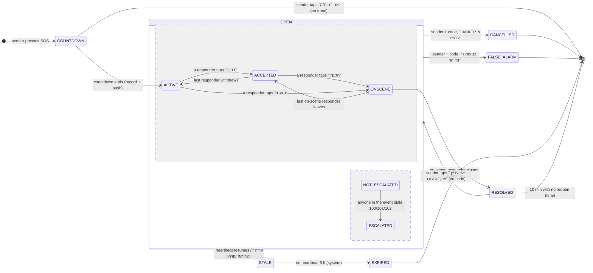

# SH✡MER: Event lifecycle spec (SOS event control)

> Planning pass, 2026-11-03. Nothing in the code has changed yet.
> Problem (Dave, 3 Nov): *"When shomers arrive to help, they need to be able to communicate from the event and 'close' it, or escalate to additional emergency services if needed. Right now the whole operational side is confused, the workflow is weird and not coherent between users and the system dashboard. All components must agree and communicate events perfectly."*
>
> Line numbers refer to `origin/main` @ `5ed7fb1` (`shomer.html`, `dashboard.html`, `functions/`, `database.rules.json` in this repo) and to `3shamrocksstudio.github.io` @ `2ff667e` (`shomer-command/app/dashboard.html`, shown as **CMD**). Other agents are editing `shomer.html` right now, so the line numbers will drift. Search for the function names.

---

## 1. The current event model, read from the code

### 1.1 Where an SOS is created and what it carries

| Step | Code | What happens |
|---|---|---|
| Press | `onSosTap` 5936, `triggerSOS` 5388, `beginSOS` 5410 | `sosPhase='countdown'`. The local siren starts. Nothing leaves the phone. |
| Countdown cancel | `cancelCountdown` 5463 | Back to `idle`. No trace is left, so it counts as a false alarm (local counter only). |
| Countdown ends | `activateSOS` 5480 | `sosPhase='active'`, `curSosId='s'+Date.now()`, `curSosType='unknown'` (5499) |
| Broadcast A, "bus" | `sosBroadcast` 12845 → `invites/sos_<uid>_<salt>` | `{fromUid, ts, name:"1\|name\|lat\|lng\|tag"}`. These are the 60-character packed rules-era payloads. |
| Broadcast B, record | `fbPublishSOS` 11495 → `sos/<uid>` | `{uid,id,lat,lng,type,typeState,ts,resolved:false,repeated?}`. There is one record per person, and each new SOS overwrites it. |
| Public row | `fbDashSos` 11515 → `dashown/sf_<rand>` + `dashfeed/sf_<rand>` | `{type, lat,lng (2 dp), ts, status:'active'}` |
| Push | `fbAlertPairedSos` 13834 → `alarms/*` → `alarmFanout`; and `sosFanout` (functions/index.js 27) on `sos/{id}` write; and `fbTriggerPush` 11510 (Worker URL is empty, line 57) | **Not deployed** (FIREBASE-DEPLOY.md 6-7) |
| Heartbeat | `sosHeartbeat` 12896, every 4 min | Updates `ts` on the bus and on `sos/<uid>`. The **dashfeed row is never refreshed.** |
| Type | `classifySOS` 3240 → `fbUpdateSOSType` 11511 | Updates `sos/<uid>.type`. The dashfeed row is **not** updated. |

**States today:**
- Phone (`sosPhase`): `idle → countdown → active → idle`.
- Server (`sos/<uid>`): `resolved:false → true`.
- Local outcome (`resolveAs` 5911): `real | accidental | test`. This value stays on the phone and is never sent.
- Dashboard: `active | resolved`, plus the operator's own `open | handled | closed`, which is kept only in that browser's localStorage.

### 1.2 Who sees it

| Role | What they get today | Code |
|---|---|---|
| Sender | A red strip "SOS פעיל". A help bar "עזרה בדרך" with responder names and the nearest distance. A "help is coming" sound layer. A "call police?" bar after 2 s. A restore bar after a reload. | 5527-5555, 13221, 13172, 12931 |
| Sender's SHOMERs (paired) | A full-screen `in-sos` overlay with a siren (`playAlarm(2500)` 13018), a map pin, and a separate "live event" card | `showIncomingSOS` 13034, `fbSosProcess` 11546, `openLiveSosDetail` 11641 |
| Nearby users (not paired) | **Nothing in the app.** `incomingSosAlert` / `showSosBanner` (11585/11615) are never called. `sos/<uid>` can be read only by people the sender paired with (rules 66). `sosFanout` would push to them (≤5 km, functions 46), but when they open the app there is nothing to see. | |
| Municipal dashboard | An anonymous dashfeed row. It is polled every 12 s (dashboard.html 1503). | dashboard.html 1451-1490 |

### 1.3 Actions per role today

| Action | Sender | Paired SHOMER | Dashboard operator |
|---|---|---|---|
| Accept / on my way | – | "אני בדרך" in the overlay (13048) or on the event card (11699). Both write `invites/rp_<myUid>`. | – |
| Arrived / on scene | – | **None.** The card button reads "בטל - לא יכול/הגעתי" (11652), which *withdraws* the responder. | – |
| Signals | – | "עדכון" opens `openSignalSheet` (12100). It sends `medic/defib/police/ambul/safe/ended` to `invites/rs_<myUid>`. | – |
| Chat | none | none | "הודעה לקבוצה" only logs "לא נשלחה" (CMD 1216) |
| Call | 100 bar (5545) | Call the sender (`callThem` 13080). The card has 100 only (11668). | Text only: "פרטי האירוע מוכנים להעברה ידנית" (CMD 1220) |
| Silence the alarm | – | "השתק אזעקה" asks over `sd_<victim>`, and the sender must confirm (13248-13305) | Mutes its own tone (CMD 1177) |
| Close | Cancel code → `resolveSOS` 5888 → real/accidental/test | **Cannot.** The "ended" signal is only a 6-second ticker (12140). | "האירוע טופל" changes only its own localStorage (CMD 2425, 2368). The app never hears about it. |
| Escalate | 100 bar only | 100 only | "סמן לשיגור", which is not wired (CMD 1122-1129) |

### 1.4 How state syncs

- The app uses RTDB listeners: `sos/<puid>` (11538), the bus `invites/sos_*` (12985), `rp_*` (13194), `rs_*` (12129) and `sd_*` (13267).
- The **dashboard polls `/dashfeed.json` over REST every 12 s** and reads nothing else.
- No path carries information from the dashboard back to the app.
- No event-scoped node exists. Responders, signals and stand-downs are keyed **per user**, not per event.

### 1.5 Breaks: broken, contradictory or missing (file:line)

| # | Severity | Finding | Where |
|---|---|---|---|
| B1 | **Critical** | **The dashboard never recognises an app SOS as an SOS.** The app writes `type: curSosType\|\|'sos'`, and `curSosType` is `'unknown'` at that moment, so the row says `'unknown'` (or `med/viol/...` once the type is chosen). The dashboard treats only `type==='sos'` as an SOS. The row shows up as a plain yellow "דיווח": no beacon, no alarm, no response checklist. | shomer.html 5499, 11505, 11522; dashboard.html 1025; CMD 1094 |
| B2 | **Critical** | **A fake responder classifies every SOS.** If nobody picks a type within 14 s, `scheduleSosFallback` calls `classifySOS('med','responder')`. That writes `type:'med'` to the real `sos/<uid>` that the sender's SHOMERs see, and the sender gets the toast "A nearby SHOMER classified this". This is fabricated data. | 3256-3260, 3240-3251, 5536, 11511 |
| B3 | **Critical** | **A responder cannot mark "arrived" and cannot close the event.** "Arrived" withdraws them (the label is "בטל - לא יכול/הגעתי"), so the sender's help bar goes away just as help arrives. "האירוע הסתיים" is a 6-second ticker that changes no state. Only the sender, with the code, can end the SOS. | 11652, 11701-11706, 12077-12083, 12140-12150, 5888 |
| B4 | **Critical** | **The dashboard's "close" does not reach anyone.** Operator status, the log and the checklist live only in the browser's localStorage. Dispatch, "תגבור" and "הודעה לקבוצה" are not wired. A second operator, or the same operator on another PC, sees a different status. | dashboard.html 1273, 1291; CMD 1122-1129, 1313, 2367-2368, 2425 |
| B5 | **High** | **A stale "on my way" shows up in the next SOS.** `rp_<responderUid>` is one record per responder with no event id. It is never cleared when the SOS ends (`rpTrackStart` only stops its timer), and the sender's watcher has no age check. The sender's next SOS immediately shows "שומר בדרך" from the last event. Two parallel SOSes overwrite each other. | 13107-13128, 13189-13202, 12960-12971 |
| B6 | **High** | **A false alarm stays on the public dashboard.** "Accidental" or "test" shows the toast "הוסר מהמפה, לא שותף עם אחרים", but the dashfeed row only flips to `resolved`. It is then listed as a past event for 30 days and counted in stats. | 5911-5925, 11512; dashboard.html 1486 |
| B7 | **High** | **Three different stale clocks.** The app hides the peer pin after 25 min (11553). The overlay shows "SOS ישן" after 30 min (12895, 13010). The dashboard keeps a row "חי" for 24 h, because the row's `ts` is never refreshed (12896-12912; dashboard.html 1485). Nothing ever expires an abandoned event. | as listed |
| B8 | **High** | **Two parallel SOS channels must agree.** The legacy bus (`invites/sos_<uid>_<salt>`) and `sos/<uid>`. The alert clears only when both say inactive (13022-13025). A failed write on either one keeps the alert alive, or splits the sender's view from the SHOMERs' view. | 12845-12879, 11495-11506, 13002-13025 |
| B9 | **High** | **The push story is inconsistent** (and not deployed). Paired SHOMERs would get **two** pushes: `alarmFanout` via `fbAlertPairedSos`, and `sosFanout`. The `sosFanout` body uses `sos.name`, which the rules forbid (rules 69-71), so it always says "Someone needs help". A device with no stored location counts as "near" every SOS in the country (functions 46). Nearby non-paired users get a push and then find nothing in the app. | 13834-13841; functions/index.js 27-58; rules 66 |
| B10 | Medium | **Responders cannot see each other, or the count is wrong.** `rp_` can be read only by the responder's own partners (rules 25), so two SHOMERs of the same sender do not know about each other. The event card shows "N שומרים בדרך" counting only *me* (11666). `fbRespondersListen` is retired (`return;` at 11712). | 11666, 11710-11713 |
| B11 | Medium | **Signals are not tied to an event.** `rs_<uid>` goes to every partner of the responder, including people who have nothing to do with the event. They are watched only once at startup (11289), so a SHOMER paired later sees no signals until a reload. | 12077-12098, 12122-12138, 11289 |
| B12 | Medium | **Escalation covers police only, with no location readout.** The event card and the sender bar dial 100 only. The 101/102 buttons exist elsewhere in the app (7114) but not inside the event. Nothing records that services were called, and the dashboard never learns about it. | 5541-5552, 11668 |
| B13 | Medium | **Closing without a code is possible.** If the sender never set a cancel code, a tap on SOS ends the event for everyone (only a "tip" toast appears). | 5905-5907 |
| B14 | Medium | **Retention gaps.** `sos/<uid>` closed records and the `invites/` bus records (`sos_`, `rp_` with the responder's last position, `rs_`, `sd_`) are never deleted. That breaks the 90-day rule. | rules 64-73, 25-27; functions/retention.js |
| B15 | Low | **Two dashboard copies have drifted apart.** The response checklist (`SC_STEPS`) exists only in CMD (2357). The team features exist only in this repo's copy. An operator's workflow depends on which copy they open. | dashboard.html vs CMD |
| B16 | Low | **The broadcast toast overpromises.** "SOS שודר - שומרים בקרבתך עודכנו" is shown regardless of who actually received the SOS. Only paired SHOMERs do, and only in the foreground. | 5540 |

---

## 2. One coherent lifecycle

### 2.1 Principle

**There is one record per event, and one function derives the state everywhere.**

- Every SOS event gets an id (`eid`). Its sender-owned record stays at `sos/<ownerUid>` (already one per person and already private).
- Everything others add goes in **event-scoped** child paths keyed by `<ownerUid>/<eid>`: responders, messages and a close request.
- The app (every role), the Cloud Functions and the dashboard mirror all compute the state with **the same pure function, `eventState()`**, kept in one shared file `event-state.js`. That is how "all components agree".

### 2.2 State machine



- `ESCALATED` is a flag that runs alongside the main states, not a separate step. An event can be `ONSCENE` and `ESCALATED` at the same time.
- `STALE` is shown to the user but is not stored. Clients derive it from `beat`.

### 2.3 Who may move each transition

| Transition | Sender | Responder (paired SHOMER) | Dashboard operator | System |
|---|---|---|---|---|
| COUNTDOWN → ACTIVE | ✔ (automatic) | | | |
| → ACCEPTED / ONSCENE / back | | ✔ (own row only) | | |
| → ESCALATED | ✔ | ✔ | – (records "contacted services" on its own board only) | |
| → CANCELLED | ✔ with code | | | |
| → FALSE_ALARM | ✔ with code | | | |
| ONSCENE → RESOLVED | | ✔ only while their own row is `onscene` | ✖ (NEEDS DAVE, Q3) | |
| RESOLVED → OPEN (reopen) | ✔ one tap, **no code** | | | |
| → EXPIRED | | | | ✔ function (6 h with no beat) |
| Operator ack / handled | | | ✔ (`dashops`, never closes the person's event) | |

**Safety rules**
- **Reopening never needs a code.**
- **Closing by anyone other than the sender can always be undone by the sender**, which protects against a coercive "guardian".
- The cancel code still guards sender close, as today. **B13 fix:** if no code is set, a sender close asks "בטוח/ה? החזק/י 2 שנ׳" (hold-to-confirm) instead of closing on one tap.

### 2.4 `eventState()`: the one derivation (shared file)

```js
// event-state.js: loaded by shomer.html, both dashboards (mirror subset), and functions/.
// sos = sos/<owner>; resp = sosr/<owner>/<eid>; close = sosc/<owner>/<eid>; msgs = sosm/<owner>/<eid>
function eventState(sos, resp, close, msgs, now){
  if(!sos || !sos.id) return {phase:'none'};
  const CLOSED = {cancelled:1, false_alarm:1, expired:1, resolved:1};
  const legacyClosed = sos.state == null && sos.resolved === true;        // old clients
  const beat = sos.beat || sos.ts;
  const rs = Object.values(resp||{}).filter(r => r && r.ts > (sos.reopenTs||sos.ts) - 1);
  const n = rs.filter(r => r.st==='enroute' || r.st==='onscene').length;
  const onscene = rs.some(r => r.st==='onscene');
  const esc = Object.values(msgs||{}).filter(m => m && m.k==='esc').map(m => m.svc);
  let phase;
  if(CLOSED[sos.state]) phase = sos.state;
  else if(legacyClosed) phase = 'cancelled';
  else if(close && close.ts > (sos.reopenTs||0)) phase = 'resolved';    // responder close, sender phone may be dead
  else if(now - beat > 6*3600e3) phase = 'expired';
  else phase = onscene ? 'onscene' : (n ? 'accepted' : 'active');
  return {phase, n, onscene, esc:[...new Set(esc)], stale: !CLOSED[phase] && now-beat > 30*60e3,
          open: !CLOSED[phase] && phase!=='resolved'};
}
```

Every screen, sound, push and dashboard row below is a function of this output. Nothing keeps a private copy of the state.

### 2.5 What each role sees and hears at each state

| State | Sender | Responder (tapped "בדרך") | Other SHOMERs of the sender | Dashboard operator |
|---|---|---|---|---|
| ACTIVE | Red strip "SOS פעיל". Siren. "נשלח ל-N שומרים" (real count from the function, else "נשלח לשומרים שלך"). Bar: 100/101/102. | (n/a) | Full-screen alert, siren + vibration. Push: "🆘 SOS מ<שם>". Buttons: בדרך / נווט / התקשר / לא יכול/ה. | New red SOS row, beacon, klaxon, checklist step 1 "אישור קבלה" |
| ACCEPTED | Help bar "עזרה בדרך · <שמות> · הקרוב/ה 400 מ׳". The hi-lo help sound (existing). Push if the app is backgrounded. | Small status card "את/ה בדרך", live route. Buttons: הגעתי / הודעות / התקשר / לא יכול/ה. | The alert shrinks to "<שם> בדרך אליה/ו" (siren stops after 60 s, NEEDS DAVE Q6). | Chip "שומר בדרך · 1" |
| ONSCENE | "<שם> הגיע/ה" with the arrival flourish (existing band 4) and a spoken line. | On-scene card: הודעות / חייג 101/100/102 / **סגירת אירוע** | "<שם> בזירה" | Chip "שומר בזירה" |
| ESCALATED (flag) | Banner "הוזמן מד״א 101 · ע״י <שם>" | Same banner. The location readout card stays open. | Same banner. Push: "הוזמן 101 לאירוע של <שם>". | Chip "הוזמנו שירותי חירום: 101" |
| STALE (30 min) | Restore bar (existing): "עדיין צריך/ה עזרה?" | Card turns grey: "לא עודכן 34 דק׳ - התקשר/י" | Same quiet "SOS ישן" (existing, no siren) | Row is amber: "לא עודכן 34 דק׳" |
| RESOLVED (by responder) | Screen: "<שם> סגר/ה את האירוע · <סיבה>". Big button "**אני עדיין צריך/ה עזרה**" (reopen, no code). The siren stops. | "האירוע נסגר" → summary → back to the map | Push (same tag, replaces the SOS one): "האירוע של <שם> נסגר". The alert goes away. | Row → "נסגר · <סיבה>", alarm stops, checklist jumps to "תיעוד" |
| CANCELLED (sender) | "בוטל. כולם עודכנו." | "<שם> ביטל/ה - הכול בסדר". The route ends. | Push (replaces): "<שם> בטוח/ה". | "נסגר ע״י הפונה" |
| FALSE_ALARM | "סומן כטעות - נמחק מהלוח הציבורי" (true, because the row is deleted) | "התרעת שווא - אפשר לחזור" | Push (replaces): "התרעת שווא - הכול בסדר" | **Row deleted** (it disappears on the next poll) |
| EXPIRED | Next app open: "ה-SOS נסגר אוטומטית אחרי 6 שעות ללא עדכון" | "האירוע פג תוקף" | Same | "פג תוקף (ללא עדכון)" |

**Sounds stay as they are:** the sender's siren, the guardian's `playAlarm`, the help layer, the dashboard klaxon. Every one of them now **stops on the same derived `open===false`**.

**Push:** only when the app is backgrounded, and **always with the tag `sos-<eid>`**, so each update *replaces* the last notification instead of stacking.

### 2.6 In-event communication

- **Quick replies** (one tap; event-scoped `sosm`). Responder side: `בדרך` · `הגעתי` · `צריך מד״א` · `צריך משטרה` · `המשטרה הגיעה` · `האמבולנס הגיע` · `המצב בשליטה`. Sender side: `אני בסדר` · `אני לא יכול/ה לדבר` · `אני זז/ה` · `תתקשרו אליי`. These replace the 6 `SIGNALS` (12077) and keep their icons.
- **Short text**, up to 140 characters, for the sender and responders (NEEDS DAVE Q2).
- **System lines** go in the same thread: "<שם> בדרך", "<שם> הגיע/ה", "הוזמן 101", "נסגר: <סיבה>", "נפתח מחדש". Each one appears once, generated from the state changes. Everyone reads the same log.
- **One-tap call to the sender:** `tel:+<phoneCanon>` (existing `callThem`), on every responder screen. The sender gets "התקשר/י" next to each responder they have a number for.
- **Silence alarm:** the existing `sd_` remote stand-down with the sender's confirmation stays. In step 7 it moves to an `sosm` message `k:'sd'`.

### 2.7 Escalation (100/101/102)

- "חייג/י" opens a **location readout card** first, then the dialer. The card shows:
  - "מה להגיד למוקד" with the address,
  - coordinates (`31.8985, 35.0105`),
  - the event type,
  - the time it started,
  - "המיקום מעודכן לפני 40 שנ׳".
  
  The address comes from a reverse geocode (NEEDS DAVE Q5: this sends the location to OpenStreetMap). Without it, only coordinates and a "פתח במפות" link are shown.
- Tapping **101 / 100 / 102** opens `tel:` (the existing `ambulanceNum/policeNum/fireNum`, localised outside Israel). It also writes one `sosm` message `{k:'esc', svc:'a'|'p'|'f'}`. The app **cannot verify** that a call was made, so the label is "חויג 101 מהאפליקציה".
- The existing disclaimer stays on every event screen: **"⚠ SH✡MER אינו תחליף לחיוג 100 / 101 / 102"**. SH✡MER never calls the authorities itself.

### 2.8 Closing

| Who | How | Reason (enum) | Effect |
|---|---|---|---|
| Sender | Cancel code (or hold-to-confirm without a code) → "איך זה נגמר?" | `safe` (אני בטוח/ה עכשיו) → CANCELLED · `accidental` / `test` → FALSE_ALARM | Writes `sos/<owner>.state` + `closedTs/closedBy/reason`. The legacy `resolved:true` is kept. Deletes the dashfeed row on FALSE_ALARM. |
| On-scene responder | "סגירת אירוע" → reason → "סגור לכולם" | `handled` (טופל במקום) · `services` (הועבר לכוחות/מד״א) · `transported` (פונה לבית חולים) · `other` | Writes `sosc/<owner>/<eid>`. Every client derives RESOLVED at once, even when the sender's phone is dead. The sender's phone (or the function) also writes `sos.state='resolved'`. Final after 10 min with no reopen. |
| System | No beat for 6 h | `expired` | The function writes `state:'expired'`. The dashboard derives it from `beat` anyway. |

**How a close spreads:**
- **App clients:** they listen to `sos/<owner>` and `sosc/<owner>/<eid>` (RTDB, live). They get the change within about 1 s and run `eventState()`, which stops sirens, routes and timers.
- **Background phones:** they get the replacing push.
- **Dashboard:** it gets the change within one poll (≤12 s) through the mirrored dashfeed row.

### 2.9 Retention (existing 90-day rule)

- `sos/<owner>` when closed, plus `sosr/sosm/sosc/<owner>/<eid>`: deleted 90 days after `closedTs`.
  - Done by `privacyRetention` (extended).
  - Fallback: the rules let any signed-in account delete such a record, the same pattern as `palerts`.
- Dashfeed rows: the existing 90-day delete rule stays. FALSE_ALARM rows are deleted right away.
- `dashops/<key>`: 90 days.
- The legacy bus records `invites/sos_*`, `rp_*`, `rs_*`, `sd_*` are deleted after the bus is retired (step 7).

### 2.10 Privacy check (CLAUDE.md data policy)

**Public `dashfeed` row:**
- Fields: `type:'sos'`, `sub` (coarse bucket), `status`, `n` (count), `ts`, `beat`, `closedTs`, `reason`, `lat/lng` rounded to 2 dp (~1 km).
- The location is set **once, at the start**. It is never updated from later heartbeats, so the row cannot be used to track a person.
- **No uid, name, phone or precise location.**
- `sub` uses coarse buckets `med | safety | fire | other`. A sexual-assault or stalking SOS is never named publicly (NEEDS DAVE Q4).

**Precise location, names and messages:**
- They stay in `sos/`, `sosr/`, `sosm/`, which only the sender and the people the sender paired with can read.
- A responder's live position is written only while they are `enroute`, and is cleared on `onscene` or `left`.
- **New reader:** the sender's other SHOMERs now see each other's *first name and status* inside the event (NEEDS DAVE Q1). They never see each other's phone numbers.

**Operator and server side:**
- `dashops/<key>` is written by operators. It holds the ack time and status only, no free-text notes; notes stay local as today. It never contains a person id.
- The relay to the app (`opAck`) is done server-side through the private `dashown` mapping.
- `tokens` locations stay server-only (`.read:false`). Fix: a token with no location is **not** treated as "near" (B9).

**Before shipping:** update the published privacy policy (privacy.html + Nature privacy) to cover event messages and the responder list. Tag: NEEDS YOUR EYES.

---

## 3. Screens: role × state (Hebrew wireframes)

**Sender: ACTIVE → ACCEPTED**
```
┌──────────────────────────────────┐
│ 🔴 SOS פעיל · מיקומך משותף       │
│ נשלח ל-3 שומרים                  │
├──────────────────────────────────┤
│ 🛡 עזרה בדרך                      │
│ דני · מיכל          הקרוב/ה 400 מ׳│
├──────────────────────────────────┤
│ [אני בסדר] [לא יכול/ה לדבר]       │
│ [תתקשרו אליי] [💬 הודעות 2]       │
├──────────────────────────────────┤
│ [🚑 101] [🚓 100] [🚒 102]        │
│ ⚠ SH✡MER אינו תחליף לחיוג 100/101/102│
│        [ביטול SOS (קוד)]          │
└──────────────────────────────────┘
```

**Responder: alert received (ACTIVE)**
```
┌──────────────────────────────────┐
│ ✕                    התרעת SOS   │
│            מיכל                  │
│      זקוק/ה לעזרה - עכשיו         │
│      סוג: רפואי · 1.2 ק״מ · לפני 1 דק׳│
│ [   אני בדרך   ] [נווט/י] [התקשר/י]│
│ [ לא יכול/ה ]                     │
│ 🔕 בדקתי שהם בטוחים - השתק אזעקה  │
│ ⚠ SH✡MER אינו תחליף לחיוג 100/101/102│
└──────────────────────────────────┘
```

**Responder: on the way (ACCEPTED)**
```
┌──────────────────────────────────┐
│ את/ה בדרך למיכל · 650 מ׳ · 3 דק׳  │
│ גם דני בדרך                       │
│ [ ✔ הגעתי ] [💬] [📞] [לא יכול/ה]  │
└──────────────────────────────────┘
```

**Responder: on scene (ONSCENE)**
```
┌──────────────────────────────────┐
│ ✔ את/ה בזירה · מיכל               │
├──────────────────────────────────┤
│ 💬  דני: בדרך · 2 דק׳             │
│     מיכל: אני לא יכולה לדבר       │
│     מערכת: הוזמן 101 ע״י דני       │
│ [צריך מד״א][המשטרה הגיעה][בשליטה] │
│ [ כתוב/י הודעה…            ][שלח] │
├──────────────────────────────────┤
│ [🚑 חייג 101] [🚓 100] [🚒 102]   │
│ [📞 התקשר/י למיכל]                │
│ [      סגירת אירוע       ]        │
└──────────────────────────────────┘
```

**Escalation readout (before the dialer opens)**
```
┌──────────────────────────────────┐
│ מה להגיד למוקד 101               │
│ 📍 רח׳ עמק דותן 12, מודיעין        │
│ 🧭 31.8985, 35.0105 (עודכן לפני 40 שנ׳)│
│ ⏱ התחיל 21:42 · סוג: רפואי         │
│ "אני שומר/ת בזירה, אדם זקוק לעזרה" │
│ [   📞 חייג/י 101 עכשיו   ] [ביטול]│
└──────────────────────────────────┘
```

**Responder: close**
```
┌──────────────────────────────────┐
│ סגירת האירוע לכולם                │
│ ( ) טופל במקום                    │
│ ( ) הועבר לכוחות / מד״א           │
│ ( ) פונה לבית חולים               │
│ ( ) אחר                           │
│ מיכל תוכל/י לפתוח מחדש בלחיצה.     │
│ [ סגור לכולם ]   [ חזרה ]          │
└──────────────────────────────────┘
```

**Sender: closed by a responder (RESOLVED)**
```
┌──────────────────────────────────┐
│ ✔ דני סגר/ה את האירוע · טופל במקום │
│ האזעקה הופסקה. השומרים עודכנו.    │
│ [  אני עדיין צריך/ה עזרה  ]        │  ← reopen, no code
│ [ סגור ]                          │
└──────────────────────────────────┘
```

**Dashboard: live row and checklist**
```
┌ חי עכשיו · לטיפול מיידי ──────────────── 1 ┐
│ 🆘 קריאת SOS · רפואי   לפני 4 דק׳          │
│ [שומר בזירה] [הוזמן 101]  עודכן לפני 1 דק׳ │
└─────────────────────────────────────────────┘
 מה עושים עכשיו                         2 / 5
 ✔ אישור קבלה   (← האפליקציה: "מוקד הרשות ראה")
 ✔ איתור על המפה
 ● יצירת קשר ושיגור   [יצרנו קשר ✓] [מרכז התגובה]
 ○ סגירת האירוע  ← נסגר אוטומטית כשהאירוע נסגר באפליקציה
 ○ תיעוד ודוח
```

---

## 4. Data model changes

```
sos/<ownerUid>                          (exists; owner-only write; read: owner + pairs/<owner>/<me>)
  uid, id(=eid), lat, lng, ts(=opened), type, typeState, repeated         (exist)
  resolved, resolvedTs                                                    (exist, kept as a legacy mirror)
  beat:      number   last heartbeat      (NEW; heartbeat writes beat, not ts)
  state:     'open'|'cancelled'|'false_alarm'|'resolved'|'expired'        (NEW)
  closedTs, closedBy:'owner'|'responder'|'system', reason, closerNm(≤12)  (NEW)
  reopenTs:  number   set when the sender reopens a responder-closed event    (NEW)
  notified:  number   push successes      (NEW, written by function)
  opAck:     number   operator acknowledged (NEW, written by function)

sosr/<ownerUid>/<eid>/<responderUid>     (NEW: responders, event-scoped)
  st:'enroute'|'onscene'|'left', ts, nm(≤12), lat?, lng? (4 dp, only while enroute)

sosm/<ownerUid>/<eid>/<msgId>            (NEW: event messages, append-only)
  u(=auth.uid), k:'q'|'t'|'esc'|'sys'|'sd', q?(code), t?(≤140), svc?('p'|'a'|'f'), ts

sosc/<ownerUid>/<eid>                    (NEW: close by an on-scene responder)
  u(=auth.uid), reason:'handled'|'services'|'transported'|'other', nm(≤12), ts

sosfk/<ownerUid>                         (NEW: server-only: the sender's anonymous dashfeed key)
  "<sf_key>"

dashfeed/<sf_key>                        (exists; public; extended)
  type:'sos', sub:'med'|'safety'|'fire'|'other', status:'active'|'accepted'|'onscene'|'escalated'|
  'resolved'|'cancelled'|'expired', n:0..50, ts, beat, closedTs?, reason?, lat, lng (2 dp)

dashops/<sf_key>                         (NEW: shared operator board; command accounts only)
  ack?:ts, st:'open'|'handled'|'closed', contacted?:{p?:ts,a?:ts,f?:ts}, at:ts
```

**Retired in step 7:** `invites/sos_*`, `invites/rp_*`, `invites/rs_*`, `invites/sd_*` and the `responders/` remnant.

---

## 5. Database rules (additions; merge into database.rules.json)

```json
"sos": { "$uid": {
  ".read":  "auth != null && (auth.uid === $uid || root.child('pairs').child($uid).child(auth.uid).exists())",
  ".write": "auth != null && (auth.uid === $uid || (!newData.exists() && data.child('closedTs').val() < now - 7776000000))",
  ".validate": "!newData.exists() || (newData.hasChildren(['uid','lat','lng','ts']) && newData.child('uid').val() === $uid && newData.child('lat').isNumber() && newData.child('lng').isNumber() && newData.child('ts').isNumber())",
  "name":  { ".validate": false },
  "state": { ".validate": "newData.val().matches(/^(open|cancelled|false_alarm|resolved|expired)$/)" },
  "reason":{ ".validate": "newData.val().matches(/^(safe|accidental|test|handled|services|transported|other|expired)$/)" },
  "notified": { ".validate": false }, "opAck": { ".validate": false }
}},
"sosr": { "$owner": { "$eid": {
  ".read": "auth != null && (auth.uid === $owner || root.child('pairs').child($owner).child(auth.uid).exists())",
  ".write": "auth != null && !newData.exists() && root.child('sos').child($owner).child('closedTs').val() < now - 7776000000",
  "$r": {
    ".write": "auth != null && $r === auth.uid && root.child('pairs').child($owner).child(auth.uid).exists() && root.child('sos').child($owner).child('id').val() === $eid && root.child('sos').child($owner).child('resolved').val() === false",
    ".validate": "newData.hasChildren(['st','ts']) && newData.child('st').val().matches(/^(enroute|onscene|left)$/) && newData.child('ts').isNumber() && newData.child('ts').val() <= now + 60000",
    "nm":  { ".validate": "newData.isString() && newData.val().length <= 12" },
    "lat": { ".validate": "newData.isNumber()" }, "lng": { ".validate": "newData.isNumber()" },
    "st": { ".validate": true }, "ts": { ".validate": true },
    "$other": { ".validate": false }
}}}},
"sosm": { "$owner": { "$eid": {
  ".read": "auth != null && (auth.uid === $owner || root.child('pairs').child($owner).child(auth.uid).exists())",
  ".write": "auth != null && !newData.exists() && root.child('sos').child($owner).child('closedTs').val() < now - 7776000000",
  "$mid": {
    ".write": "auth != null && !data.exists() && (auth.uid === $owner || root.child('pairs').child($owner).child(auth.uid).exists()) && root.child('sos').child($owner).child('id').val() === $eid && (root.child('sos').child($owner).child('resolved').val() === false || root.child('sos').child($owner).child('closedTs').val() > now - 600000)",
    ".validate": "newData.hasChildren(['u','k','ts']) && newData.child('u').val() === auth.uid && newData.child('k').val().matches(/^(q|t|esc|sys|sd)$/) && newData.child('ts').val() <= now + 60000",
    "t":   { ".validate": "newData.isString() && newData.val().length <= 140" },
    "q":   { ".validate": "newData.isString() && newData.val().length <= 16" },
    "svc": { ".validate": "newData.val().matches(/^(p|a|f)$/)" },
    "u": { ".validate": true }, "k": { ".validate": true }, "ts": { ".validate": true },
    "$other": { ".validate": false }
}}}},
"sosc": { "$owner": { "$eid": {
  ".read": "auth != null && (auth.uid === $owner || root.child('pairs').child($owner).child(auth.uid).exists())",
  ".write": "auth != null && ((newData.exists() && root.child('sosr').child($owner).child($eid).child(auth.uid).child('st').val() === 'onscene' && root.child('sos').child($owner).child('id').val() === $eid && root.child('sos').child($owner).child('resolved').val() === false && (!data.exists() || data.child('ts').val() < root.child('sos').child($owner).child('reopenTs').val())) || (!newData.exists() && root.child('sos').child($owner).child('closedTs').val() < now - 7776000000))",
  ".validate": "!newData.exists() || (newData.hasChildren(['u','reason','ts']) && newData.child('u').val() === auth.uid && newData.child('reason').val().matches(/^(handled|services|transported|other)$/) && newData.child('ts').val() <= now + 60000)"
}}},
"sosfk":  { "$uid": { ".read": false, ".write": "auth != null && auth.uid === $uid", ".validate": "newData.isString() && newData.val().beginsWith('sf_')" } },
"dashops":{ ".read": "auth != null && root.child('founders').child(auth.uid).exists()",
            "$k": { ".write": "auth != null && root.child('founders').child(auth.uid).exists() && $k.beginsWith('sf_')",
                    ".validate": "newData.hasChildren(['st','at']) && newData.child('st').val().matches(/^(open|handled|closed)$/)" } }
```

**dashfeed:** add `sub`, `n`, `beat`, `closedTs`, `reason` validators next to `status`; `$other:false` stays.

```json
"sub": { ".validate": "newData.val().matches(/^(med|safety|fire|other)$/)" },
"n":   { ".validate": "newData.isNumber() && newData.val() >= 0 && newData.val() <= 50" },
"beat":{ ".validate": "newData.isNumber() && newData.val() <= now + 600000" },
"closedTs": { ".validate": "newData.isNumber()" },
"reason": { ".validate": "newData.val().matches(/^(handled|services|transported|safe|other|expired)$/)" },
"status": { ".validate": "newData.isString() && newData.val().length <= 24" }
```

**Notes**
- `sos.resolved===false` is the "open" test that works for both old and new clients. New clients keep writing `resolved` as `state !== 'open'`.
- `dashops` uses `founders` until the command-accounts work (branch `dashboard-lock`) provides a per-territory operator role. Then this switches to that role.
- Rules deploy: Claude runs `firebase deploy --only database`. If the CLI has no credentials, Claude hands Dave a one-step brief.

---

## 6. Cloud Functions (coordinate with the push-alarm work)

The push-alarm agent owns **"push on SOS create"** in `sosFanout` (`onValueWritten('/sos/{id}')`). The lifecycle needs **no second trigger on `/sos/{id}`**. It adds a *transition branch* inside the same handler, plus three small functions. The two pieces of work share one helper, `pushTo(uids, {title, body, tag:'sos-'+eid})`, in `functions/push.js`.

| Function | Trigger | Does |
|---|---|---|
| `sosFanout` (existing; push-alarm agent) | `/sos/{uid}` written, `isNew` | Pushes to **paired SHOMERs**. Writes `sos/<uid>/notified = successCount`. Creates the dashfeed row with a random `sf_` key, stores it in `sosfk/<uid>` and `dashown/<key>`. Lifecycle asks for: (a) a Hebrew body with no name, using the recipient-side invite name if one exists, otherwise "SOS מאחד/ת השומרים שלך"; (b) `t.lat==null` must **not** count as near; (c) the nearby-strangers push behind a flag (NEEDS DAVE Q1b); (d) the client `fbAlertPairedSos` removed in the same release, which ends the double push. |
| `sosFanout` transition branch | Same handler, `before.state !== after.state` or `resolved` flips | Pushes the close or reopen to everyone in `sosr/<uid>/<eid>` plus paired SHOMERs, same tag (it replaces the SOS notification). Mirrors to the dashfeed row (status/closedTs/reason); deletes the row on `false_alarm`. |
| `incidentSync` | `/sosr/{owner}/{eid}/{r}`, `/sosc/{owner}/{eid}`, `/sosm/{owner}/{eid}/{m}` (k=esc only) | Runs `eventState()`. Mirrors `status/n` (and `escalated`) to the dashfeed row through `sosfk`. Pushes to the sender on the first `enroute` and the first `onscene`. Pushes escalations to the guardians. On `sosc`, writes `sos.state='resolved'` + `closedBy` / `reason` / `closerNm`. |
| `incidentOpAck` | `/dashops/{key}` written (`ack` set) | `dashown/<key>` → owner → writes `sos/<owner>/opAck`. The app shows "מוקד הרשות ראה את הקריאה". |
| `incidentExpire` | Schedule every 15 min (same Blaze scheduler as `privacyRetention`) | Open events with `beat` older than 6 h → `state:'expired'`, mirrored, push "נסגר אוטומטית". |
| `privacyRetention` (extended) | Daily (existing, not deployed) | Deletes closed `sos/<uid>` + `sosr/sosm/sosc/<uid>/<eid>` + `dashops/<key>` once older than 90 days; deletes the legacy bus records. |

**Without functions** (today), the lifecycle still works between app clients, because every client derives state from the same records. The sender's client mirrors the dashfeed row while the sender's phone is alive. Functions are needed for:
- background pushes,
- the dashboard learning about a close while the sender's phone is dead,
- operator ack reaching the app,
- expiry and retention.

---

## 7. Dashboard changes

1. **Recognise SOS rows** (fixes B1):
   - Treat `type==='sos'`, **or any key starting with `sf_`**, as an SOS. This also catches legacy rows typed `unknown/med/...`.
   - Label from `sub`.
   - Both copies: `dashboard.html` 1025 and CMD 1094.
2. **Phase chips** from `status`/`n`: חדש · שומר בדרך (n) · שומר בזירה · הוזמנו שירותי חירום · נסגר (reason) · פג תוקף.
3. **Staleness from `beat`:**
   - amber "לא עודכן X דק׳" after 30 min;
   - shown as expired after 6 h.
   - This replaces the 24 h `ts` window (dashboard.html 1485, CMD 1557).
4. **Closed by the app ⇒ the board follows:** when the row turns `resolved/cancelled/expired`, the klaxon stops, the checklist marks "סגירת האירוע" done (with the reason in the log) and moves on to "תיעוד ודוח". Operator "האירוע טופל" becomes **"טופל מצד הרשות"**: it writes `dashops.st='handled'` and is shown separately. It never claims the person is safe.
5. **Shared board:**
   - `ack`, `st` and `contacted` go to `dashops/<key>`, so every operator sees the same status.
   - Free-text notes and the incident report stay local (no PII in shared storage).
   - "אישור קבלה" writes `ack`, which the app shows to the sender as "מוקד הרשות ראה את הקריאה".
6. **Honest dispatch:** the dispatch, "תגבור" and "הודעה לקבוצה" buttons stay labelled "טרם חובר" until a real channel exists. No change in this spec.
7. **Single source:** port the lifecycle changes into one dashboard file and copy it to CMD with the existing staging header. Avoid editing two copies by hand (B15).
8. **False-alarm rows** disappear (the row is deleted). Past-event lists and stats then stop counting them.

---

## 8. Implementation plan: small, shippable steps

Each step ships on its own, bumps the app version, and passes the QA gate.

| # | Step | Effort | Acceptance tests |
|---|---|---|---|
| 0 | **`event-state.js` + tests.** A pure function with unit tests for every transition and for legacy records. No UI. | 0.5 d | Node test: 20+ cases (open/accepted/onscene/each close/reopen/stale/expired/legacy `resolved:true`) all pass. |
| 1 | **Stop the contradictions** (no new paths): remove `scheduleSosFallback` (B2); dashfeed `type:'sos'` + coarse `sub` + `beat` on every heartbeat; false alarm/test **deletes** the dashfeed row (B6); toast "נשלח ל-N שומרים שלך" (B16); dashboard recognises `sf_`/`sos` (B1) plus `beat` staleness (B7); no-code close needs hold-to-confirm (B13). | 1 d | (a) SOS on phone A → the dashboard shows a red SOS row with a beacon within 15 s. (b) Leave the type blank for 30 s → `sos/<A>.type` stays `unknown`. (c) Accidental → the row is gone from `/dashfeed.json`. (d) Kill the app → the dashboard row turns amber after 30 min. |
| 2 | **Event-scoped responders** (`sosr` + rules): בדרך / הגעתי / לא יכול/ה; the sender and all SHOMERs see the same list and count; dual-write `rp_` for clients older than this version; the sender's watcher ignores `rp_` older than the event (B5, B3 arrived, B10). | 1.5 d | (a) B taps בדרך → A's help bar shows B within 2 s; C (another SHOMER of A) sees "B בדרך". (b) B taps הגעתי → A hears the arrival flourish and sees "B הגיע/ה"; the help bar stays. (c) A's next SOS starts with 0 responders. (d) A non-paired account gets permission-denied writing `sosr/A/…`. |
| 3 | **Unified close and reopen:** `sos.state/closedTs/reason`; sender close reasons; `sosc` responder close (on scene only) + the sender's "אני עדיין צריך/ה עזרה"; every screen, siren and route keyed off `eventState().open`; the sender's client mirrors the dashfeed status/n; retire the dual-channel AND (B8: the bus becomes write-only fallback). | 1.5 d | (a) B on scene closes "טופל במקום" → A's siren stops, A sees the reopen button, C's alert clears, dashboard row "נסגר · טופל במקום" within 15 s. (b) A taps reopen → B and C re-alerted, row back to live. (c) B tries to close while only `enroute` → denied. (d) A closes with code → everyone cleared. |
| 4 | **Event messages + escalation:** `sosm` quick replies + 140-character text + system lines; one-tap call to the sender; escalation readout card + 100/101/102 + `esc` message; the dashboard chip "הוזמנו שירותי חירום"; `SIGNALS` mapped onto quick replies (B11, B12). | 1.5 d | (a) B sends "צריך מד״א" → A and C see it within 2 s, in order. (b) B taps 101 → readout card with coordinates → dialer opens with 101; A and C see "הוזמן 101 ע״י B"; dashboard chip appears. (c) A message after close+10 min → denied. (d) Disclaimer visible on every event screen. |
| 5 | **Dashboard workflow:** phase chips; checklist auto-advances on app close; `dashops` shared ack/status; ack visible to the sender; one source file copied to CMD (B4, B15). | 1.5 d | (a) Operator 1 acks → operator 2 (another browser) sees "אושר" within 15 s. (b) App close → checklist "סגירת האירוע" done with the reason. (c) The exported report has no uid, name or exact location (grep). |
| 6 | **Functions** (with the push-alarm agent; needs Dave's deploy OK, Q7): transition pushes with the replacing tag; `incidentSync` mirror; `incidentOpAck`; `incidentExpire`; retention extension; `fbAlertPairedSos` removed (B9, B14). | 1 d + deploy | Emulator suite: create → 1 push per paired device; close → the same tag replaces it; `sosc` with the sender offline → the dashboard row closes; 6 h no beat → expired; 91-day-old closed event → all four paths deleted. |
| 7 | **Retire the legacy bus** after two releases with no client below the step 3 version: stop writing `invites/sos_/rp_/rs_/sd_`; move the stand-down to `sosm k:'sd'`; delete old bus records. | 0.5 d | No writes to `invites/(sos_|rp_|rs_|sd_)` in a 24 h log sample; SOS end-to-end tests (2a-4d) still pass. |

**Total:** about 9 working days of build. Steps 1-5 need no new server deployment beyond the rules.

---

## 9. Decisions that NEED DAVE (product only)

| # | Question | Recommended default |
|---|---|---|
| Q1 | When one of your SHOMERs is on the way, should your other SHOMERs see their first name and distance? | **Yes**: first name + status only, never their phone. |
| Q1b | Should nearby users who are *not* the sender's SHOMERs get the SOS (push + map pin)? | **Not in this version.** Only the sender's own SHOMERs. Strangers would be a separate "community responders" feature. |
| Q2 | In-event messages: quick replies only, or also short free text? | **Both**: quick replies first, free text up to 140 characters. |
| Q3 | Can the municipal operator close a person's SOS? | **No.** The operator marks "טופל מצד הרשות" and "ראינו את הקריאה". Only the sender or an on-scene SHOMER closes. |
| Q4 | On the public dashboard, how specific is the SOS type? | **Coarse**: רפואי / ביטחון אישי / אש / אחר. Never "sexual assault" or "stalking" publicly. |
| Q5 | Show a street address on the "what to tell 101" card? This sends the location to OpenStreetMap at that moment. | **Yes, only when tapped**, with coordinates always shown. Add one line to the privacy policy. |
| Q6 | After the first SHOMER says "on my way", should the siren stop on the other SHOMERs' phones? | **Yes, after 60 s.** Their alert stays on screen, quietly. |
| Q7 | OK to switch on the server part (background push, auto-close, 90-day cleanup)? It needs the Firebase Blaze plan; expected cost ≈ $0 at current volume (≈$0.10/month per extra scheduled job beyond 3). | **Yes.** Without it, a locked phone does not ring. |
| Q8 | Auto-close an event with no update from the sender's phone after…? | **6 hours.** From 30 min it shows as "לא עודכן", quietly. |
